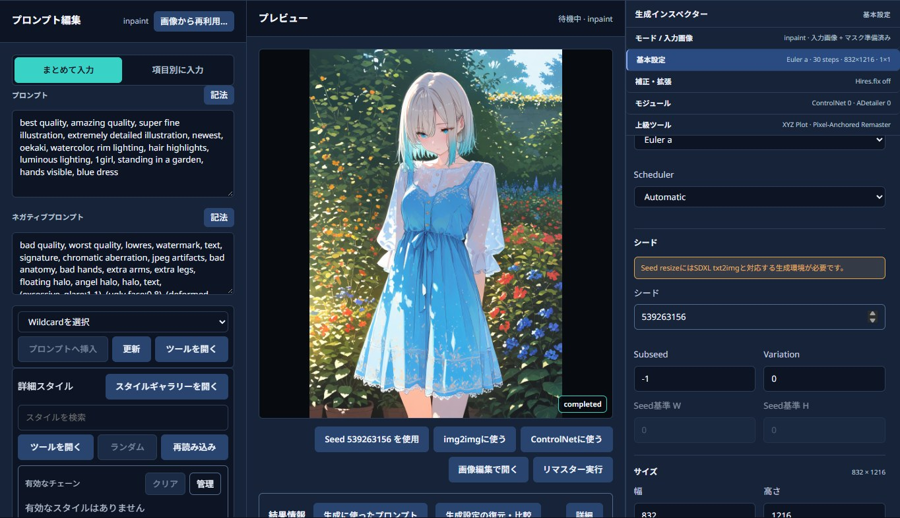
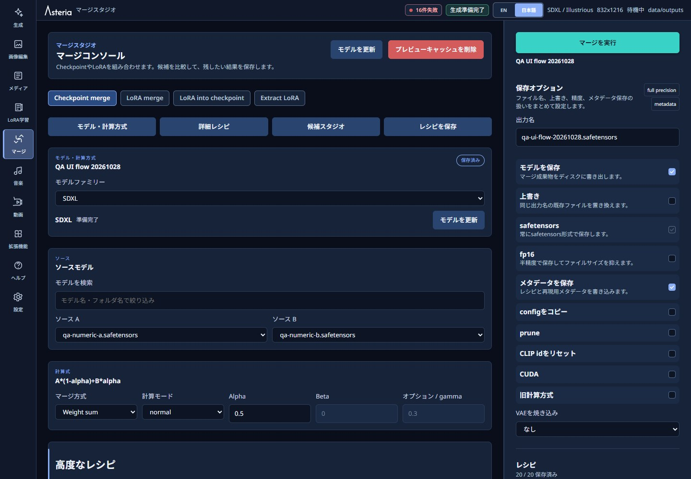

# Asteria V1.2.0 Windows Portable

[日本語](#日本語) | [English](#english)

**画像・動画・音楽の生成から、編集、整理、LoRA学習、モデルのMergeまで。Windowsで使うローカルAI制作アプリです。**

**A local AI creation app for Windows: generate images, video and music, then edit, organize, train LoRAs and merge models.**



画面例はDarkモード・日本語表示です。必要な情報は以下の日本語・英語の案内から確認できます。

Screenshots show the Japanese interface in Dark mode. Choose your language below for setup, guides and release details.

## 日本語

### 概要

Asteriaは、Windowsのローカル環境で画像・動画・音楽を作り、Media Libraryで成果物を一か所に集めて確認・整理できるAI制作アプリです。入力を選び、生成や編集を実行し、結果を保存して再利用するまでを同じアプリで完了できます。画像生成用のモデルや任意の動画・音楽モデルは、用途に合わせて選択または用意してください。初回起動時には、Asteriaが必要な実行環境を取得します。

画面例のテーマと言語は設定から変更できます。起動後の最初の操作は[画面付きクイックスタート](guides/QUICK_START.md)を参照してください。

### まず始める

1. [必要環境](#必要最低限のスペックと動作環境)を確認し、[ZIPの展開と初回セットアップ](#インストール方法)へ進みます。
2. 手持ちのモデルを[追加・共有](#モデルの追加)するか、起動後に任意のスターターパックを選びます。
3. [画面付きクイックスタート](guides/QUICK_START.md)で、一枚の生成、画像の選択、マスク編集を試します。
4. 普段は`Start-Asteria.cmd`で起動し、終了時は`Stop-Asteria.cmd`を使います。[起動・停止・修復の説明](#起動方法)も確認してください。

> **dev版を利用する方へ（2026年10月21日更新）**：描写位置を指定する配置機能はV1.2.0から外しました。配置画面と配置付き生成は利用できません。通常の生成と、ポジティブプロンプトをベース・キャラクター・詳細に分ける項目別入力は引き続き利用できます。過去の配置付き設定を再利用すると、対象の文章は対応する欄へまとめられます。位置の指定は引き継がず、元の履歴や画像は変更しません。V1.1.2までの修正も含みます。

### 今回の使いやすさの改善

- GenerateとMergeに「モデルを検索」を追加しました。名前やフォルダー名で候補を絞り込み、選択中のモデルは検索語を変えても保持します。
- Mergeはモデル・計算方式、詳細調整、候補比較、レシピ保存の順に操作できます。PCの通常幅では、右上の実行ボタンは設定や履歴をスクロールしても表示されたままです。
- 詳細スタイルのカードをLoRAと同じサイズへそろえ、長い名称は省略表示にしました。保存プロンプトの2カラム選択欄のずれも修正しました。



詳しい操作は[クイックスタート](guides/QUICK_START.md)を参照してください。自動リピートの終了条件は、初期値がすべて`0`（上限なし）です。以前に保存した条件は引き継ぐため、連続生成の前に確認してください。

### 主な機能

V1.2.0では、次の制作の流れをまとめて扱えます。

| やりたいこと | 主な機能・操作ガイド |
|---|---|
| 画像を生成・編集する | txt2img、img2img、inpaint、Hires.fix、ControlNet、Detailer、Topaz。[クイックスタート](guides/QUICK_START.md) |
| プロンプトや生成条件を比べる | AIプロンプト作成、保存プロンプト、生成に使ったプロンプト、プロンプトの比較生成、ワイルドカードの部分固定、途中状態からの分岐。[制作支援](guides/CREATIVE_WORKFLOWS.md) |
| 結果を確認・整理する | 画像・動画・音声のMedia Library、体の部位を検出・選択、再生成条件の比較。[メディア管理](guides/MEDIA_LIBRARY.md)／[完成画像の身体チェック](guides/IMAGE_CHECK.md) |
| 動画や音楽を作る | MiniMax H3の5タスクとSequence、MiniMax-Music3のVocal／Instrumental。[動画](guides/VIDEO_STUDIO.md)／[音楽](guides/MUSIC_STUDIO.md) |
| LoRA学習・モデル合成を行う | 学習素材の確認、LoRAの学習・実用テスト、Merge XYZ、Moment Weave／Log Weave／Dual Residual |
| 自分の制作環境を整える | 外部モデルライブラリ、Discord連携、[拡張機能](guides/EXTENSIONS.md)、Light／Dark／System、Anima 2.9B／3.8B対応 |

<details>
<summary>機能ごとの詳しい説明を開く</summary>

- **画像を作る・整える**: txt2img／img2imgで新規画像を作ったり、元画像を変換したりできます。Hires.fix、ControlNet、Detailer、Topaz Photo AI連携で仕上がりも調整できます。
- **画像・動画・音声を管理する**: マスクや切り抜きで編集した結果をMedia Libraryに保存し、画像・動画・音声の再生、比較、評価、タグ付けまで続けて行えます。
- **体の部位を見比べて編集する**: 「体の部位を検出・選択」で、任意モデルが検出した矩形候補を確認・修正・除外できます。SAMがある場合だけ実マスクを作り、既存の画像編集へ渡せます。複数画像の同じ部位も並べて確認できます。人体異常や人物所属を自動判定する機能ではありません。
- **再生成の条件差を調べる**: 生成設定の復元・比較の「生成時の数値を比較」で、資産、実入力、Seed、記録されたsigmaや初期ノイズの指紋を比較できます。過去に保存していない値は「未記録」と表示します。同Seedでも完成画像の画素一致は保証しません。
- **Video Studioで動画を仕上げる**: MiniMax H3のText、Image、First / Last Frame、Reference / Video Edit、Sequenceを使い分けられます。Sequenceでは各クリップを確認してから続行または連結するため、採用した部分を保ったまま完成させられます。
- **Music Studioで曲を作る**: MiniMax-Music3でVocalまたはInstrumentalを選び、用途に合う新しい曲を生成できます。
- **設定を再利用する**: スタイル、ワイルドカード、Embedding、LoRA、生成プリセットを組み合わせ、PNG／JPEG／WebPからプロンプトや対応する生成設定を読み込んで次の生成に使えます。
- **プロンプトを分けて入力する**: ポジティブプロンプトをベース、キャラクター、詳細の三つに分け、表示名と並び順を用途に合わせて変更できます。生成時は指定した順に一つのプロンプトへまとめ、履歴、生成プリセット、画像のメタデータからも同じ構成を復元できます。
- **プロンプトを整える**: 選択した文字の重みをCtrl＋↑／↓で調整し、記法メニューから強調、弱化、数値指定、候補、段階切り替え、交互切り替え、AND、BREAKを入力できます。AIプロンプト支援では、用途に合わせて標準、Anima、Illustrious、Danbooruタグへ変換を選べます。
- **LoRAを学習する**: 学習画像とキャプションを用意して学習を実行し、完成したモデルをモデル一覧から選べる状態にします。
- **モデルを組み合わせる**: Merge StudioでCheckpointやLoRAの条件を比べ、Weight sum、MBW、Merge XYZから方式を選択できます。Moment Weave、Log Weave、Dual Residualは違いを見ながら合成するためのAsteria独自方式です。
- **作業を追いかける**: Light／Dark／Systemを切り替え、別画面へ移動しても進行状況を確認し、必要なら取消・再試行できます。
- **手持ちのモデルを共有する**: 外部モデルライブラリを登録すれば、Asteria／ComfyUI／Forge系の保管先を移動せずに利用できます。
- **外部から生成する**: Generateで公開した設定だけをDiscordの許可したサーバーやチャンネルから実行できます。
- **機能を拡張する**: Extensionsでカタログ、URL／GitHub、ローカルZIP、拡張機能フォルダーを選び、Asteriaの画面や操作を追加できます。Safe Modeなら起動を妨げる拡張機能を止めて復旧できます。

</details>

### 更新履歴

<details>
<summary>V1.2.0と以前のバージョンの変更を開く</summary>

利用者向けの変更を記載しています。dev版の対象範囲は「まず始める」の案内を確認してください。

#### V1.2.0

- 描写位置を指定する配置機能を対象から外しました。項目別入力は文章を整理する機能として残り、各欄の文章を指定した順に結合します。欄ごとに描写位置を指定する機能ではありません。
- Video Studioでは、Text、Image、First / Last Frame、Reference / Video Edit、Sequenceの5タスクから目的に合う動画作成を選べます。使用するモデルや構成、Steps、Sampler、Schedulerなどを選び、生成後に結果を確認してからアップスケールできます。Sequenceではクリップをプレビューし、**このクリップを再試行**、**採用して次へ**、**採用して完成**から次の操作を選びます。最後の連結だけ失敗したときは、採用済みクリップを作り直さず再試行できます。
- Music Studioでは、VocalとInstrumentalを別々に下書きし、モデル構成、Steps、Sampler、Scheduler、曲の長さ、Seedなどを選べます。MiniMax-Music3の処理が失敗しても有料APIへ切り替わりません。
- Generateでは、ポジティブプロンプトを「まとめて入力」と「項目別に入力」から選べます。項目別入力では、ベース、キャラクター、詳細の表示名と並び順を変更できます。生成時は項目の間へ区切りを補って一つのプロンプトにまとめ、履歴、生成プリセット、画像のメタデータからも同じ構成を復元できます。
- Generateでは、選択した文字の重みをCtrl＋↑／↓で0.1ずつ調整できます。記法メニューから強調、弱化、数値指定、候補、段階切り替え、交互切り替え、AND、BREAKを入力できます。
- 自動リピートの進行確認を修正しました。進行通知が途切れた場合は同じ生成の状態を確認し直します。履歴の読み込み待ちで次の生成を止めず、生成自体が失敗した場合は理由を表示して停止します。
- 自動生成に最大試行枚数、最大時間、合格枚数の終了条件を追加しました。失敗や不合格も試行枚数に含め、終了時は理由を表示します。
- 生成に使ったプロンプトで、ワイルドカードの展開、重み、記法、実際に使ったモデルへの入力を確認できます。プロンプトの比較生成では一つの変更を同じSeedで比べ、条件名を隠して好みを選べます。ワイルドカードは髪色など一部の選択だけを固定できます。
- 「AIプロンプト作成」で場面の説明からプロンプト案を作れます。「保存プロンプト」ではよく使う文章を保存・追加でき、「AIで矛盾確認」では意味の食い違いの候補を調べられます。提案は確認してから適用し、入力文を勝手に書き換えません。
- HiresやDetailerの前後の画像、生成過程の動画・GIF、生成途中の状態を任意で保存できます。対応する生成では、保存した途中状態から文章や条件を変えて別の候補を作れます。
- Media Libraryで条件への一致やシリーズ内の変化を確認し、判定を訂正できます。生成設定の復元・比較では、保存した設定と現在のモデルの違いを確認して再利用できます。画像対応AIの判定には見逃しや誤判定があります。
- 体の部位を検出・選択、SAMで作成したマスクの編集転送、2〜32画像の同種部位比較を追加しました。検出とマスク作成は利用者が実行したときだけ動き、必要なモデルは任意導入です。
- 通常生成でも、実際に使ったsigma列、初期ノイズと入力latentの指紋、計算先を小さな記録として残します。生成設定の復元・比較で確認でき、未記録の過去値は推測しません。通常の生成計算は変えません。
- LoRA学習用の画像とcaptionを点検し、学習後は服・背景・ポーズを変えた生成で効果を比べられます。AIの注釈候補は確認用であり、勝手にcaptionを変更したり学習を始めたりしません。
- 生成時に語句の参照範囲を記録し、手直しして部分編集へ渡せます。範囲は正確な部位の輪郭ではありません。複数人のポーズは一つの制御画像として編集できますが、AnimaのLLLiteではポーズへの追従を保証しません。
- 完成画像の身体チェックを追加しました。生成・補正を終えた完成画像を、保存前に画像対応AIで一回確認し、不合格画像を保存するか選べます。Settingsでは履歴の画像を選び、設定を保存する前に判定を試せます。AIには見逃しや誤判定があり、独自の人体判定器は現在選べません。[操作と制約](guides/IMAGE_CHECK.md)を確認してください。
- AIプロンプト支援では、用途に合わせて標準、Anima、Illustrious、Danbooruタグへ変換を選べます。OpenAI互換の接続先では、利用できるモデルの一覧を取得して選べます。
- Settingsに「生成時のRAM使用量を抑える」を追加しました。大きな動画や連続生成でRAMが不足する場合に選べます。単発生成は遅くなる場合があり、変更はAsteriaの次回起動時に反映されます。
- Media Libraryでは画像・動画・音声をまとめて扱えます。動画をVideo Studioへ渡し、音楽は設定だけを引き継いで作り直せます。
- Extensionsではカタログ、URL／GitHub、ローカルZIP、手動フォルダーを選べます。標準拡張はAsteriaが許可した機能だけを利用します。フルアクセス拡張はAsteriaと同じ利用者権限でコードを実行します。更新、元に戻す、無効化、Safe Modeからの復旧は明示操作と再起動で反映されます。
- AsteriaがAnima 2.9B（40ブロック）とAnima 3.8B（52ブロック）を見分け、画像生成とMerge Studioで必要な選択肢を表示します。MBWでは、既存の全プリセットを各ブロック構成に合わせて選べます。
- Anima 2.9B／3.8Bでは、LLLiteが生成結果に作用することを確認しています。ただし、現在の位置や構図の制御は実験段階です。狙った位置や構図を保証するものではないため、強さと範囲を調整しながら結果を確認してください。
- 旧28ブロックAnima向けLoRAは、Anima 2.9Bで使えるように再配置できます。Anima 3.8Bでは結果をまだ確認できないため、自動変換しません。
- AnimaではQwen2D-Anime VAEも選べます。必要な読み込み機能はAsteriaに含まれるため、別の拡張機能を追加する必要はありません。
- Merge StudioではMoment Weave、Log Weave、Dual Residualを、Weight sumでモデルを組み合わせる際の計算方法として選べます。MBWの部位別設定やMerge XYZの比較にも使えます。
- 詳しい操作方法は[制作支援](guides/CREATIVE_WORKFLOWS.md)、[完成画像の身体チェック](guides/IMAGE_CHECK.md)、[Extensions](guides/EXTENSIONS.md)、[Video Studio](guides/VIDEO_STUDIO.md)、[Music Studio](guides/MUSIC_STUDIO.md)、[Media Library](guides/MEDIA_LIBRARY.md)を参照してください。

#### V1.1.2

- 管理対象ZIPの一時展開パスを、Asteriaの`temp/`内に作る短いフォルダーへ変更しました。従来は配置先より展開中だけパスが長くなる問題があり、ControlNet用コンポーネントなどを導入できない場合がありました。
- 最終的な配置先のパスが長すぎる場合は、`setup_path_too_long`とともに原因と対処方法を表示します。Asteriaを`D:\Asteria`などの短いパスへ移動してから、`Repair-Asteria.cmd`を実行してください。
- Settingsから導入や修復を行った場合も、パスが長すぎる状態と、以前のコンポーネントを復元できない状態を区別して案内します。修復の前に生成環境を停止した場合は、修復に失敗しても再起動を試みます。
- `.cmd`から起動した場合も、配布ファイルのSHA-256を確実に検証します。

#### V1.1.1

- Asteriaの配置先に空白を含むフォルダーを選んだ場合でも、正常に起動できるよう修正しました。

#### V1.1.0

- 長時間の処理は画面を移動しても状態が残り、進行状況の確認、取消、再試行、復旧結果の確認まで行えます。
- ダウンロードが中断しても続きから再開でき、バックアップ／復元や管理対象更新ではデータを保護できます。
- Light／Dark／Systemを選び、どの画面でも共通の処理状況を確認できます。
- 外部モデルライブラリを登録すると、元のモデルファイルを移動せずに安定して参照できます。
- Windows標準のファイル／フォルダー選択で場所を選べます。外部モデルライブラリは構成とモデル数を自動判定するため、初回登録で内部形式や数値優先度を入力する必要がありません。
- Merge StudioではSLERP、NuSLERP、Nearswapも選べます。Weight sum、MBW、Merge XYZで合成結果を比べるときに利用できます。
- Generate設定を明示的に公開すると、許可範囲、進行表示、取消、混雑制御、配送失敗時の復旧案内を備えたDiscord生成を利用できます。
- Settingsの「診断」では、秘匿情報やプロンプト、絶対パス、プロセス詳細を含めずに状況を共有できます。安全に復旧できる実行環境は、同じ画面から再起動できます。
- 診断の警告から次の対応を確認でき、Discord設定では各IDの取得場所と使い方を確認できます。
- Lightテーマのガイド、詳細カード、XYZ、AIプロンプト支援などを読みやすくし、再訪時には読み込み済みデータを再利用します。
- 画像ライブラリへ戻った時は、表示中の一覧を残したまま最新72件だけを確認するようにしました。新しい生成画像をすぐ確認でき、更新に失敗しても現在の一覧は消えません。
- Windows標準の参照画面を開いている間は、アプリ内の参照画面が重ならず、選択操作に集中できます。
- PNG／JPEG／WebPを選び、Asteria、A1111／Forge、一般的なComfyUIのメタデータを確認して再利用できます。画像のプロンプトだけ、現在のSeedを変えずに生成設定、画像入力、Seedだけを個別に適用でき、適用だけでは生成を開始しません。
- 壊れた値や極端に大きい画像メタデータも安全に部分表示でき、同じ画像入力の重複登録を防ぎます。
- 全画面の配色と面の区切りを整理し、通常／実行／選択／削除操作を見分けやすくしました。Light／Dark／Systemのどれでも読みやすく、画面構成と操作順はそのまま使えます。
- 操作できる場所と入力・作業の面を見分けやすく整理し、文字と余白も読みやすくしました。必要な操作や別レイヤーだけに控えめな奥行きを付けています。
- 閉じる操作を×アイコンへ統一し、Libraryのフォルダー列、画像一覧のスクロール境界、狭い画面でのImage Edit／Library／Mergeの配置を使いやすくしました。
- Asteriaのロゴとテーマ対応のアイコンを整え、小さい表示でも判別しやすくしました。閉じるアイコンを中央に置き、AIプロンプト支援／履歴の余白とMerge履歴列の横スクロールを改善しました。
- 操作できる行やボタンだけが反応するように整理し、閉じる操作や履歴の確認を迷わず行えます。
- 英数字と日本語の書体を整え、日本語ラベルや見出しが不自然に一字だけ折り返されないよう、ボタンや隣接操作を単位として表示します。
- Libraryの前後移動でプレビューが意図せず閉じず、Generateを含むボタン文字も縦に揃います。狭い画面でも履歴や長い文字列を横スクロールせず確認できます。

#### V1.0.4

- 手持ちのCheckpointやVAEを設定している場合に、スターターパック不足の警告が残る問題を修正しました。
- 生成画像とは別に、中間PNGが`outputs/`へ残る問題を修正しました。
- 生成結果と履歴で、画像の生成時間を確認できるようにしました。
- LoRAと同じ名前の画像をサムネイルとして表示できるようにしました。ジャンクションやシンボリックリンクで共有しているLoRAにも対応します。
- SettingsにRuntime Monitorを追加しました。次回起動時に別ウィンドウで生成ログを確認でき、Monitorを閉じてもAsteria本体は終了しません。
- 生成結果や履歴から、選択した画像のSeedだけを現在の生成設定へ適用できるようにしました。

#### V1.0.3以前

- **V1.0.3** — LibraryとImage Editの長期利用・データ保護、Generate／Merge XYZ、Topaz／Eagle連携、モデル参照と操作UIを強化しました。
- **V1.0.2** — Generateのモデル一覧キャッシュ、Generation Preset、Prompt & Assets、画面を移動したときの更新処理を改善しました。
- **V1.0.1** — Merge XYZ、Windowsのリンク経由モデル、Portable版の初期設定と修復を強化しました。
- **V1.0.0** — Windows Portable初回公開版です。

</details>

### 必要最低限のスペックと動作環境

- 64-bit版Windows 10またはWindows 11
- x64 CPU
- CUDA対応のNVIDIA GPU
- NVIDIAドライバー 570.65以上
- インターネット接続
- 展開先への書き込み権限
- 初回取得、追加するモデル、生成画像を保存できる空き容量

AMD／Intel GPUとCPUのみの実行には対応していません。macOSとLinuxもV1.2.0では未対応です。

必要なGPUメモリとシステムメモリは、モデル、生成解像度、LoRA学習などの作業で変わります。高解像度生成や学習を始める前に、余裕のあるメモリを確保してください。

### インストール方法

1. ZIPを完全に展開します。十分な空き容量がある書き込み可能なフォルダーを選び、ZIP内から直接起動しないでください。展開したフォルダーがAsteriaの作業場所になります。
2. 展開先にある`Start-Asteria.cmd`をダブルクリックして、セットアップを始めます。
3. 初回セットアップでは、Python、Node.js、ComfyUI、必要なパッケージ、カスタムノード、機能用データを取得して検証します。CMDウィンドウは、完了またはエラーが表示されるまで閉じないでください。
4. 必須セットアップが完了すると、Asteriaがブラウザーで開きます。
5. 画像生成モデルが必要な場合は、AsteriaのSettingsから「起動準備」を開きます。SDXL、Anima、両方、または「モデルなしで続行」を選んでください。

Windowsへ事前にインストールする必要があるのは、対応するNVIDIAドライバーです。CUDA Toolkit、Python、Node.js、ComfyUIを個別に導入する必要はありません。

初回取得には時間がかかり、機能用データだけでも数十GBになる場合があります。開始前に画面で取得量と空き容量を確認してください。中断しても検証済みのファイルは次回に再利用されます。

SDXL／Animaスターターパックは必須ではありません。CMDで行う必須セットアップには含まれず、Asteria起動後に選択した場合だけ取得されます。両方をスキップした場合は、手持ちのモデルを追加して使用します。Animaスターターパックの取得には、画面に表示される非商用ライセンスへの同意が必要です。

### 起動方法

Asteriaを使い始めるときは、展開先の次のファイルを実行します。

`Start-Asteria.cmd`

起動後はブラウザーで作業できます。2回目以降は取得済みコンポーネントを確認し、変更がなければ再取得しません。ブラウザーのタブを閉じただけでは処理は終了しないため、終了時は必ず停止ファイルを使います。

作業を安全に終えるには、次のファイルを実行します。Asteriaが起動したPython、Node.js、ComfyUIも一緒に終了します。

`Stop-Asteria.cmd`

起動できない、または管理対象ファイルの不足・破損が疑われるときは、Asteriaを停止してから次のファイルを実行します。不足分を再検証・再取得し、再起動を試せる状態にします。

`Repair-Asteria.cmd`

### モデルの追加

手持ちのモデルを使うには、展開先の`models/`へ追加します。SDXL／Animaスターターパックを後から取得せず、対応するモデルを自分で用意することもできます。

次のフォルダーは初回起動時に自動作成されます。モデルの種類に合う場所へ配置してください。

- Checkpoint: `models/checkpoints/`または`models/diffusion_models/`
- VAE: `models/vae/`
- テキストエンコーダー: `models/text_encoders/`
- LoRA: `models/loras/`
- Embedding: `models/embeddings/`
- ControlNet: `models/controlnet/`
- ADetailer／検出モデル: `models/adetailer/`または`models/bbox/`
- 領域分割モデル: `models/segm/`
- Upscaler: `models/upscalers/`

`sdxl`や`anima`などのサブフォルダーは任意です。配置後にSettingsの「モデルアセット」で一覧を更新すると、選択画面で使えるようになります。

SDXLスターターパックは、Checkpointを`models/checkpoints/sdxl/`、VAEを`models/vae/sdxl/`へ配置します。Animaスターターパックは、モデルを`models/checkpoints/anima/`、テキストエンコーダーを`models/text_encoders/anima/`、VAEを`models/vae/anima/`へ配置します。

#### 別の場所にあるモデルを共有する

モデルを別の場所に置いたまま使うには、Settingsの「外部モデルライブラリ」で共有`models`フォルダや既存のAsteria／ComfyUI／Forge系保管先を登録します。`StableDiffusion`／`Stable-diffusion`、`Lora`、`Embeddings`、`adetailer`、`bbox`、`segm`などを自動判定し、登録先のモデル本体は移動・削除しません。接続できない場所はオフラインになり、再接続後に再スキャンできます。

従来どおり、`models/`内のジャンクションまたはシンボリックリンクで共有することもできます。リンクを作る場合は、まず`Stop-Asteria.cmd`でAsteriaを終了してください。

Windowsで同じモデルを複数の場所から使うには、管理者権限を要求しにくいジャンクションが便利です。Asteriaを停止してから、コマンドプロンプトで次を実行します。

```bat
mklink /J "<Asteriaのモデル種別フォルダー内に作るリンク>" "<既存モデルフォルダー>"
```

たとえば、Checkpointの共有先として`models\checkpoints\my-library`を作成できます。`my-library`の名前は任意です。ディレクトリまたはファイルのシンボリックリンクも読み込めますが、WindowsのDeveloper Modeまたは管理者権限が必要になる場合があります。

リンク作成後にAsteriaを起動し、Settingsの「モデルアセット」で一覧を更新します。リンク先に接続できればモデルを選べます。接続できない場合は利用できず、Asteriaと`Repair-Asteria.cmd`はリンク先のモデルを移動、削除、修復しません。

`models/checkpoints`や`models/vae`など、スターターパックの取得先そのものをリンクにしないでください。モデルの読み込みはできても、安全上の理由からスターターパックの取得や修復が停止する場合があります。

### 主な保存場所

- `models/`: 手持ちのモデル、スターターパック、モデルへのリンク
- `data/`: 設定、生成履歴、プリセット、画像編集用データ、学習やマージの作業データ
- `data/outputs/`: 生成画像・動画・音声、編集結果、補正後の画像。Settingsで別の保存先へ変更できます
- `logs/`: 起動処理、ComfyUI、Asteria本体の診断ログ

既定では、これらはすべて展開フォルダー内に保存されます。作業中に`data/`やSettingsで指定した生成ファイルの保存先を移動すると履歴や結果を見失うため、停止後にだけ整理してください。

### Eagle連携

生成結果をEagleでも整理するには、Eagleを起動し、Settingsの「外部ツール」でURL、送信先フォルダー、「生成完了時にEagleへ自動送信」を保存します。以後、最終生成画像が自動送信されます。

Hires.fixなどの中間画像は自動送信の対象外です。Eagleへの送信に失敗しても画像生成は完了します。接続を直した後、ライブラリの履歴から手動で再送できます。

### Discord生成

Discordから使える生成を限定するには、Settingsの「Discord」でBot接続先と許可範囲を保存し、Generateの「Discordへ公開」で設定を公開します。公開後のGenerate変更は自動反映されないため、変更時は再公開してください。公開を解除するとDiscordから生成できません。

Botトークンは保存後に再表示されません。許可するサーバー、チャンネル、ユーザーを必要最小限にし、不要になった場合は公開を解除してトークンを削除してください。

### 拡張機能

機能を追加したいときは、左メニューのExtensionsでカタログ、URL／GitHub、ローカルZIP、または拡張機能フォルダーを選びます。導入、更新、無効化、元に戻す、削除は明示操作で行い、Asteriaを再起動すると結果が反映されます。更新は自動適用されません。

標準拡張は分離した画面で動き、Asteriaが許可した機能だけを利用します。フルアクセス拡張はAsteriaと同じ利用者権限でコードを実行できるため、確認画面で提供元と要求される権限を確認し、信頼できるものだけを導入してください。起動できない場合はSafe ModeでAsteria本体を起動し、問題の拡張機能を無効化または元に戻せます。

### 診断、バックアップ、復旧

起動や実行に問題があるときは、Settingsの「診断」で準備状況と次の対応を確認します。明示的に出力する診断レポートには、プロンプト、トークン、絶対パス、プロセス情報、生ログを含めません。完了済みの記録を整理し、Asteriaが管理する実行環境も再起動できます。

設定を戻したいときは、Settingsの「メンテナンス」で互換性情報を確認してバックアップを作成します。復元前に内容をプレビューし、明示確認してから実行します。更新や復元に失敗したらAsteriaを停止し、`Repair-Asteria.cmd`で必要なファイルを直します。

### よくある質問（簡易Q&A）

#### Q. `Start-Asteria.cmd`を実行してもブラウザーが開きません。

まずCMDウィンドウの最後のメッセージを確認します。初回セットアップ中なら閉じずに完了まで待ちます。

エラーならNVIDIAドライバー、空き容量、インターネット接続、セキュリティソフトの遮断を順に確認し、`Repair-Asteria.cmd`を実行します。必須セットアップ後の失敗は`logs/launcher/`も確認します。

#### Q. 初回ダウンロードが長い、または途中で止まりました。

CMDの通信エラーを確認し、停止している場合は`Start-Asteria.cmd`をもう一度実行します。検証済みのファイルは再利用され、不足分から続きます。

#### Q. 2回目以降もダウンロードされます。

不足、破損、または配布情報の変更が検出されたものだけを再取得します。同じ項目で止まる場合は、空き容量とセキュリティソフトを確認してから`Repair-Asteria.cmd`を実行します。

#### Q. 追加したモデルが一覧に表示されません。

モデルの種類に合うフォルダーへ置いたか確認し、Settingsの「モデルアセット」で一覧を更新します。リンクなら、リンク先のドライブやネットワークにも接続できることを確認します。

#### Q. `A stale launcher record must be stopped or repaired before starting.`と表示されます。

`Stop-Asteria.cmd`で残った処理を止め、`Start-Asteria.cmd`を再実行します。同じ表示が続く場合は`Repair-Asteria.cmd`で修復します。

#### Q. 展開したフォルダーを移動できますか。

`Stop-Asteria.cmd`でAsteriaを完全に終了し、処理が止まったことを確認してからフォルダー全体を移動します。起動中は移動しないでください。

### バックアップとアンインストール

設定や成果物を残すには、先に`Stop-Asteria.cmd`を実行してから`data/`と`models/`を保存します。Settingsで生成ファイルの保存先を`data/outputs/`以外へ変更している場合は、そのフォルダーも保存してください。問題調査用の記録も必要なら`logs/`を追加します。

ジャンクションやシンボリックリンクを使用している場合、`models/`のバックアップだけではリンク先の実ファイルを保存できないことがあります。外部モデルの保管先も別途バックアップしてください。

削除するには`Stop-Asteria.cmd`で終了し、Asteriaの展開フォルダーを削除します。設定、履歴、モデル、生成画像、ログも一緒に消えるため、必要なデータは先にバックアップしてください。

### ライセンスと第三者コンポーネント

Asteria本体の利用条件は`LICENSE`で確認できます。

取得する実行環境、パッケージ、カスタムノード、モデルの提供元、固定バージョン、ライセンスは、`release-manifest.yaml`、`runtime-dependencies.yaml`、`model-dependencies.yaml`、`notices/THIRD_PARTY_NOTICES.txt`で確認できます。スターターパックを含む第三者モデルには、各配布元の利用条件が適用されます。

### 謝辞

Qwen2D-Anime VAE対応では、Anzhc氏が公開している[anzhc-qwen2d-comfyui](https://github.com/Anzhc/anzhc-qwen2d-comfyui)を参考にしました。

---

## English

### Overview

Asteria is a Windows application for local AI creation. It combines image generation and editing, video generation, music generation, artifact comparison and organization, LoRA training, and model merging. Runtime components are acquired on first launch. Image checkpoints and optional video or music models are not bundled.


Screenshots show the Japanese interface in Dark mode. Language and theme are selectable in Settings. See the illustrated [Quick start](guides/QUICK_START.md) for your first steps after launch.

### Get started

1. Check the [requirements](#minimum-requirements-and-supported-environment), then follow [installation and first-run setup](#installation).
2. [Add or share your own models](#adding-models), or select an optional starter pack after launch.
3. Use the illustrated [Quick start](guides/QUICK_START.md) to generate one image, select a result and edit a mask.
4. Use `Start-Asteria.cmd` to start and `Stop-Asteria.cmd` to finish. See [starting, stopping and repairing](#starting-asteria) for details.

> **For dev users (October 21, 2026)**: Spatial prompt placement has been removed from V1.2.0. The placement editor and placement-controlled generation are unavailable. Normal generation and the three-section positive-prompt editor remain available. Reusing old placement settings combines every target's text into its corresponding section without restoring positions or changing the original history or images. This build also includes fixes through V1.1.2.

### Usability improvements in this build

- Generate and Merge now include Search models. Filter by model or folder name without changing the selected model when you edit the search.
- Merge follows models and method, advanced settings, candidate comparison, then recipe saving. At normal desktop widths, the execution button stays at the top right while settings and history scroll.
- Advanced Style cards now match LoRA card sizing and shorten long names. Two-column Saved prompts selectors are aligned consistently.


See [Quick start](guides/QUICK_START.md) for the workflow. Automatic-repeat limits default to `0` (unlimited). Previously saved limits are retained, so review them before continuous generation.

### Main features

V1.2.0 brings these workflows together:

| What you want to do | Features and guides |
|---|---|
| Generate and edit images | txt2img, img2img, inpaint, Hires.fix, ControlNet, Detailer and Topaz. [Quick start](guides/QUICK_START.md) |
| Compare prompts and generation settings | AI prompt builder, Saved prompts, Prompts used for generation, Generate a prompt comparison, partial wildcard pinning and intermediate-state branching. [Creative workflows](guides/CREATIVE_WORKFLOWS.md) |
| Review and organize results | Image, video and audio Media Library, body-part selection and generation-condition comparison. [Media management](guides/MEDIA_LIBRARY.md) / [Completed-image checks](guides/IMAGE_CHECK.md) |
| Create video and music | Five MiniMax H3 tasks and Sequence; MiniMax-Music3 Vocal and Instrumental. [Video](guides/VIDEO_STUDIO.md) / [Music](guides/MUSIC_STUDIO.md) |
| Train LoRAs and merge models | Dataset review, training and practical tests, Merge XYZ, Moment Weave, Log Weave and Dual Residual |
| Set up your studio | External model libraries, Discord, [Extensions](guides/EXTENSIONS.md), Light/Dark/System and Anima 2.9B/3.8B support |

<details>
<summary>Open the full feature descriptions</summary>

- **Generation and enhancement**: Use txt2img, img2img, Hires.fix, ControlNet, Detailer, and Topaz Photo AI integration.
- **Image editing and Media Library**: Edit with masks and crops; browse and play images, video, and audio; compare images; and organize artifacts with ratings and tags.
- **Detect and select body parts**: Inspect, correct or exclude optional-model detections, and compare the same part across multiple images. With SAM available, create a real mask and send it to the existing editor. This does not judge anatomical correctness or person ownership.
- **Compare recorded generation values**: Restore and compare generation settings compares saved assets, actual inputs, Seed, sigma values and initial-noise hashes. Missing historical values remain **Not recorded**. Matching settings or Seeds do not guarantee identical output pixels.
- **Video Studio**: Use five MiniMax H3 tasks, including a Sequence flow that pauses for review after every clip.
- **Music Studio**: Generate new Vocal or Instrumental music locally with MiniMax-Music3.
- **Reusable prompts and settings**: Reuse styles, wildcards, embeddings, LoRAs, generation presets, and compatible prompts or settings found in PNG, JPEG, and WebP images.
- **Sectioned prompt input**: Split the positive prompt into Base, Character, and Details sections, then rename or reorder them for the current workflow. Asteria combines the sections in that order and restores the same structure from history, generation presets, and image metadata.
- **Prompt tools**: Use Ctrl + Up/Down to adjust prompt weight, insert common prompt notation from a menu, and ask AI Prompt Assist for Standard, Anima, Illustrious, or Convert to Danbooru tags output.
- **LoRA training**: Prepare training images and captions, run training from Asteria, and register the result in the model list.
- **Merge Studio**: Compare checkpoint or LoRA settings and use the Asteria-native Moment Weave, Log Weave, and Dual Residual modes with Weight sum, MBW, and Merge XYZ.
- **Themes and operation status**: Select Light, Dark, or System and keep track of running work across workspace navigation, including safe cancel and retry.
- **External model libraries**: Register existing Asteria, ComfyUI, or Forge-style model locations without moving their source files.
- **Extensions**: Add Asteria workspaces and actions from the catalog, a URL or GitHub repository, a local ZIP, or an extension folder.
- **Discord generation**: Use only the Generate settings you explicitly publish from allowed Discord servers or channels.

</details>

### Release history

<details>
<summary>Open changes in V1.2.0 and earlier versions</summary>

This history covers user-facing changes. See Get started for the scope of this dev build.

#### V1.2.0

- Removed spatial prompt placement from this version. The three-section editor remains a way to organize text and join it in the selected order; it does not assign a drawing position to each section.
- Added MiniMax H3 Video Studio with Text, Image, First / Last Frame, Reference / Video Edit, and Sequence tasks. You can choose the model configuration, Steps, Sampler, Scheduler, and other generation settings, then review the result before upscaling it.
- Added per-clip Sequence review with Retry, Accept and continue, and Accept and finish. If only the final joining step fails, you can retry it without regenerating accepted clips.
- Added MiniMax-Music3 Music Studio for new Vocal and Instrumental generation, with selectable model configuration, Steps, Sampler, Scheduler, duration, and Seed. A failed local run never falls back to a paid API.
- Generate now lets you switch between one positive-prompt field and three editable sections. You can rename and reorder Base, Character, and Details. Asteria inserts prompt separators when combining them in the selected order and restores the section structure from history, generation presets, and image metadata.
- Added Ctrl + Up/Down prompt-weight adjustment and a notation menu for emphasis, de-emphasis, numeric weight, prompt alternatives, scheduled switching, alternating prompts, AND, and BREAK.
- Fixed automatic-repeat progress monitoring. If progress notifications stop, Asteria checks the same job instead of submitting another one. A pending history refresh no longer blocks the next generation; actual generation failures still stop the repeat loop with an error.
- Added automatic-generation limits for attempted images, elapsed time, and accepted images. Failed and rejected images count toward the attempt limit, and Asteria shows why the repeat stopped.
- Added **Prompts used for generation** to inspect wildcard expansion, weights, notation, and actual model input. Use **Generate a prompt comparison** to change one input while sharing the same Seed, with an optional blind preference vote. You can also pin individual wildcard choices, such as hair color, while rerolling the others.
- Added **AI prompt builder** for proposals from a scene description, **Saved prompts** for reusable text, and **AI conflict check** for possible contradictions. Suggestions require an explicit apply action and do not silently rewrite your prompt.
- Added optional before/after images for Hires and Detailer, videos and GIFs of generation progress, and saved intermediate generation states. Supported runs can continue from a saved state with edited text or settings.
- Media Library includes **Check image conditions with AI** and **Compare appearance with AI**, with editable judgments. **Restore and compare generation settings** compares recorded settings and assets with those currently available. Image-capable AI can miss problems or make incorrect judgments.
- Added Detect and select body parts, real SAM mask handoff to Image Edit, and same-part comparison across 2–32 images. Detection and masking run only on explicit request and require optional models.
- Ordinary generation now keeps bounded observations of actual sigma values, initial-noise and input-latent hashes, and compute devices. Restore and compare generation settings can compare these records without inferring missing historical values or changing ordinary generation arithmetic.
- Added LoRA dataset review and practical generation comparisons using different outfits, backgrounds, and poses. AI annotations are review suggestions; they do not automatically change captions or start training.
- You can record word-reference maps during generation, refine them, and send them to inpaint. These maps are not exact anatomical boundaries. Multi-person poses can be edited in one control image; Anima LLLite does not guarantee pose following.
- Added generated-image checking through an image-capable AI once after generation and enhancement, before saving the completed image, with a choice to keep or discard rejected images. Settings can try a saved history image before saving the check configuration. AI judgements may be wrong; an Asteria-native anatomy classifier is not currently available. See the [operation and limits](guides/IMAGE_CHECK.md).
- Added explicit Standard, Anima, Illustrious, or Convert to Danbooru tags output in AI Prompt Assist. OpenAI-compatible connections can load their available model list for selection.
- Added **Reduce RAM use during generation** under Settings. It can help when large video or repeated generation runs exhaust system RAM, may slow single jobs, and applies after restarting Asteria.
- Extended Media Library to images, video, and audio. The selected video can be sent to Video Studio, while Music regeneration copies settings without using the existing audio as an input.
- Added Standard and Full-access Extensions from the catalog, URL or GitHub, local ZIP, or manual folder. Standard extensions can use only the Asteria features you approve. Full-access extensions can run code with the same user permissions as Asteria. Updates, rollback, disable, and Safe Mode recovery remain explicit actions and take effect after restart.
- Asteria now recognizes Anima 2.9B (40 blocks) and Anima 3.8B (52 blocks) and shows the matching generation and Merge Studio choices. Existing MBW presets are available for both block layouts.
- LLLite has a confirmed effect on outputs from Anima 2.9B and 3.8B. Its current position and composition control remains experimental and does not guarantee the intended layout. Adjust the strength and area while reviewing the results.
- Legacy 28-block Anima LoRAs can be remapped for use with Anima 2.9B. Asteria does not automatically convert them for Anima 3.8B because the result has not yet been confirmed.
- Added Qwen2D-Anime VAE support for Anima without requiring a separate extension.
- Added the Asteria-native Moment Weave, Log Weave, and Dual Residual Calculation Modes for Weight sum, MBW, and Merge XYZ.
- See the guides for [Creative workflows](guides/CREATIVE_WORKFLOWS.md), [Image checks](guides/IMAGE_CHECK.md), [Extensions](guides/EXTENSIONS.md), [Video Studio](guides/VIDEO_STUDIO.md), [Music Studio](guides/MUSIC_STUDIO.md), and [Media Library](guides/MEDIA_LIBRARY.md).

#### V1.1.2

- Managed ZIP files now use a short temporary extraction path under Asteria's `temp/` directory. This prevents setup paths from becoming longer only during extraction, so components such as ControlNet support can be installed whenever their final destination fits within the Windows path limit.
- If the final destination is still too long, setup explains how to move Asteria to a shorter path such as `D:\Asteria` before running `Repair-Asteria.cmd`.
- Setup and Repair actions in Settings now distinguish an overlong path from an incomplete rollback and show the appropriate recovery steps. If Repair stops a running generation environment, Asteria attempts to restart it even when repair fails.
- Launching from a `.cmd` file no longer relies on PowerShell module auto-loading to verify the SHA-256 of distributed files.

#### V1.1.1

- Fixed Asteria failing to start when the installation path contains spaces.

#### V1.1.0

- Long-running work now keeps its status while you move between screens and can be cancelled, retried, or recovered.
- Interrupted downloads now resume from verified files, while updates, backups, and restores protect existing data.
- Added Light, Dark, and System themes plus shared operation progress across all workspaces.
- Added external model libraries with stable references while leaving source model files in place.
- Added SLERP, NuSLERP, and Nearswap to Merge Studio for Weight sum, MBW, and Merge XYZ workflows.
- Added Discord generation from explicitly published Generate settings, including allowlists, progress, cancellation, queue controls, and actionable delivery/runtime recovery.
- Diagnostics can now be shared without secrets, prompts, absolute paths, or process details, and Asteria-managed execution environments can be restarted from the same screen.
- Added concrete recovery steps to diagnostics warnings and in-place guidance showing where Discord IDs come from and how each one is used.
- Improved Light-theme readability for dynamic guides, detail cards, XYZ, and AI Prompt Assist, and reused loaded workspace data when revisiting screens.
- When returning to the Image Library, Asteria now checks only the latest 72 matching records while keeping the current list visible. New generations appear promptly, and a failed check no longer clears the list.
- Prevented the in-app path browser from appearing behind the native Windows picker.
- Added preview and reuse of Asteria, A1111/Forge, and common ComfyUI metadata from PNG, JPEG, and WebP images. Apply prompts only, compatible generation settings without changing the current Seed, the image input, or the Seed alone; applying settings never starts generation automatically.
- Made metadata preview resilient to malformed or excessively large image metadata and prevented concurrent image-input actions from registering the same image twice.
- Refreshed colors, typography, spacing, and action states across every workspace in Light, Dark, and System themes without changing the established screen structure or operation order.
- Standardized close actions as × icons and improved Library scrolling, narrow Image Edit, Library, and Merge layouts, the Asteria logo and icons, and spacing around AI Prompt Assist and History.
- Passive History and settings rows no longer react like buttons, making available actions easier to identify.
- Standardized Latin text on Noto Sans and Japanese text on Noto Sans JP. Japanese controls and headings now wrap adjacent actions or whole controls before splitting a label or leaving one character alone on the final line.
- Fixed Library previous/next controls moving and closing the preview when pressed. Button labels, including Generate controls, are vertically centered, and long Merge history and LoRA run text no longer creates unintended horizontal scrolling.

#### V1.0.4

- Fixed the starter-pack warning remaining visible when your own checkpoint or VAE is already selected.
- Fixed intermediate PNG files being left under `outputs/` in addition to the final generated image.
- Added generation-time information to results and history.
- Added LoRA thumbnails from image files with the same name, including LoRAs shared through junctions or symbolic links.
- Added Runtime Monitor under Settings. It can open on the next launch to show generation logs in a separate window, and closing it does not stop Asteria.
- Added an action to apply only the seed from a selected result or history image to the current generation settings.

#### V1.0.3 and earlier

- **V1.0.3** — Strengthened long-term Library and Image Edit safety, Generate/Merge XYZ, Topaz/Eagle integration, model handling and operation UI.
- **V1.0.2** — Refined Generate model caching, Generation Presets, Prompt & Assets and navigation refresh behavior.
- **V1.0.1** — Added Merge XYZ and strengthened Windows linked-model and Portable bootstrap/repair behavior.
- **V1.0.0** — Initial Windows Portable release.

</details>

### Minimum requirements and supported environment

- 64-bit Windows 10 or Windows 11
- An x64 CPU
- A CUDA-capable NVIDIA GPU
- NVIDIA driver 570.65 or newer
- Internet access
- Write access to the extracted folder
- Enough free space for first-run downloads, added models, and generated images

AMD and Intel GPUs and CPU-only operation are unsupported. macOS and Linux are also unsupported in V1.2.0.

GPU-memory and system-memory requirements depend on the selected model, output resolution, and workloads such as LoRA training. High-resolution generation and training require more memory.

### Installation

1. Fully extract the distribution ZIP to a writable folder with enough free space. Do not run Asteria from inside the ZIP.
2. Double-click `Start-Asteria.cmd` in the extracted folder.
3. On the first run, setup downloads and verifies Python, Node.js, ComfyUI, required packages, custom nodes, and functional assets. Keep the CMD window open until it reports completion or an error.
4. Asteria opens in the browser after required setup finishes.
5. If you need a generation model, open **Ready to start** in Settings. Select SDXL, Anima, both, or **Continue without starter models**.

The only prerequisite that must be installed in Windows is a compatible NVIDIA driver. You do not need to install the CUDA Toolkit, Python, Node.js, or ComfyUI separately.

The first download takes time and may require tens of GB for functional assets alone. Setup displays the planned download size. If setup is interrupted, files that already passed verification are reused on the next run.

The SDXL and Anima starter packs are optional. They are not part of the required CMD setup and are downloaded only after you select them in Asteria. You may skip both and add your own models instead. Installing the Anima starter pack requires acceptance of the displayed non-commercial license.

### Starting Asteria

For a normal start, run the following file from the extracted folder.

`Start-Asteria.cmd`

On later starts, Asteria verifies previously acquired components and skips downloads when nothing has changed. Closing the browser tab does not stop Asteria processes.

When you finish using Asteria, run the following file. This also stops the Python, Node.js, and ComfyUI processes started by Asteria.

`Stop-Asteria.cmd`

If the first download failed or a managed component may be missing or corrupt, run the following file. It stops Asteria, verifies the managed files, and reacquires missing items.

`Repair-Asteria.cmd`

### Adding models

Add your own models under `models/` in the extracted folder. You may skip the SDXL and Anima starter packs and use any compatible models you already have.

The following folders are created automatically on first launch. Place each file in the folder for its model type.

- Checkpoint: `models/checkpoints/` or `models/diffusion_models/`
- VAE: `models/vae/`
- Text encoder: `models/text_encoders/`
- LoRA: `models/loras/`
- Embedding: `models/embeddings/`
- ControlNet: `models/controlnet/`
- ADetailer / detector: `models/adetailer/` or `models/bbox/`
- Segmentation detector: `models/segm/`
- Upscaler: `models/upscalers/`

Additional subfolders such as `sdxl` or `anima` are optional. After adding a model, refresh the model list under **Model Assets** in Settings.

The SDXL starter pack places its checkpoint in `models/checkpoints/sdxl/` and its VAE in `models/vae/sdxl/`. The Anima starter pack places its model in `models/checkpoints/anima/`, its text encoder in `models/text_encoders/anima/`, and its VAE in `models/vae/anima/`.

#### Sharing models stored elsewhere

Register a shared `models` folder or an existing Asteria, ComfyUI, or Forge-style model location under External Model Libraries in Settings. Asteria automatically recognizes folders such as `StableDiffusion` / `Stable-diffusion`, `Lora`, `Embeddings`, `adetailer`, `bbox`, and `segm`. Both `adetailer` and `bbox` are loaded as detector sources, while `segm` is loaded as a segmentation source. Asteria does not move or delete model files at the registered location. Disconnected drives and network locations are shown as offline and can be rescanned after reconnection.

You can still share models through a junction or symbolic link inside `models/`. Stop Asteria with `Stop-Asteria.cmd` before creating a link.

A junction is the usual choice on Windows because it is less likely to require administrator privileges. Run the following command in Command Prompt.

```bat
mklink /J "<link to create inside an Asteria model-type folder>" "<existing model folder>"
```

For example, you can create `models\checkpoints\my-library` for a checkpoint library. The name `my-library` is only an example. Directory and file symbolic links are also supported, but they may require Windows Developer Mode or administrator privileges.

After creating the link, start Asteria and refresh the list under **Model Assets** in Settings. A model becomes unavailable when its link target cannot be reached. Asteria and `Repair-Asteria.cmd` do not move, delete, or repair files at the link target.

Do not replace a managed destination such as `models/checkpoints` or `models/vae` itself with a link. Reading may still work, but starter-pack installation or repair may stop to protect the linked files.

### Main storage locations

- `models/`: Your models, starter packs, and links to model libraries
- `data/`: Settings, generation history, presets, image-editing data, and LoRA or merge working data
- `data/outputs/`: Generated images, video, audio, edited images, and enhanced results. You can choose another location in Settings
- `logs/`: Diagnostic logs for startup, ComfyUI, and the Asteria application

By default, all of these locations are inside the extracted Asteria folder. Do not manually move `data/` or the output location selected in Settings while Asteria is running.

### Eagle integration

Asteria can automatically send the final generated image to Eagle. Start Eagle, then configure its URL, destination folder, and **Automatically send completed generations to Eagle** under **External Tools** in Settings.

Intermediate files such as Hires.fix passes are not sent automatically. A failed Eagle transfer does not fail image generation. After restoring the connection, you can retry the transfer manually from the Library history.

### Discord generation

After saving the Bot connection and allowlists under Discord in Settings, publish the current configuration with **Publish to Discord** in Generate. Editing Generate later does not change the Discord configuration; publish again to apply changes. Discord generation is rejected while no profile is published.

The Bot token is never displayed after it is saved. Keep server, channel, and user allowlists as narrow as practical. Unpublish the profile and remove the token when the integration is no longer needed.

### Extensions

Use Extensions in the left menu to install from the catalog, a URL or GitHub repository, a locally selected ZIP, or an extension folder. Install, update, disable, rollback, and remove are explicit user actions, and changes take effect after restarting Asteria. Updates are never applied automatically.

Standard extensions run in a separate view and can use only the Asteria features you approve. Full-access extensions can run code with the same user permissions as Asteria, so review the provider and requested permissions and install only extensions you trust. If an extension prevents normal startup, launch Asteria in Safe Mode, then disable or roll back the affected extension.

### Diagnostics, backup, and recovery

Diagnostics in Settings shows runtime readiness and actionable recovery. A diagnostics report is created only when you explicitly export it, and excludes prompts, tokens, absolute paths, process details, and raw logs. You can also clean completed records or safely restart a runtime whose Asteria ownership can be verified.

Maintenance in Settings shows compatibility information and creates backups. Restore requires both a preview and explicit confirmation. If an update or restore cannot complete, stop Asteria and run `Repair-Asteria.cmd`.

### Quick Q&A

#### Q. The browser does not open after I run `Start-Asteria.cmd`.

First check the final message in the CMD window. If first-run setup is still in progress, leave it open and wait for completion.

If an error is shown, check the NVIDIA driver, available disk space, internet connection, and security-software blocks. Then run `Repair-Asteria.cmd`. If required setup completed but application startup failed, also check the logs under `logs/launcher/`.

#### Q. The first download takes a long time or was interrupted.

Check the CMD window for a network or other error. If setup was interrupted, run `Start-Asteria.cmd` again. Verified files are reused and setup continues with the missing items.

#### Q. Asteria downloads something again on a later start.

Only missing or corrupt files, or files updated by their provider, are downloaded again. If the same item repeatedly fails, check free disk space and security software, then run `Repair-Asteria.cmd`.

#### Q. A model I added does not appear in the list.

Confirm that the file is in the folder for its model type, then refresh the list under **Model Assets** in Settings. If the model is linked, also confirm that its drive or network location is available.

#### Q. Asteria reports `A stale launcher record must be stopped or repaired before starting.`

Run `Stop-Asteria.cmd`, then run `Start-Asteria.cmd` again. If the message remains, run `Repair-Asteria.cmd`.

#### Q. Can I move the extracted folder?

Run `Stop-Asteria.cmd` and wait until Asteria is fully stopped, then move the entire folder. Do not move it while Asteria is running.

### Backup and uninstall

Before creating a backup, run `Stop-Asteria.cmd`. Save at least `data/` and `models/`. If you selected an output location outside `data/outputs/` in Settings, save that folder as well. Include `logs/` if you want to preserve diagnostic information for troubleshooting.

When junctions or symbolic links are in use, backing up `models/` may not copy the actual files at their targets. Back up external model locations separately.

To uninstall Asteria, stop it with `Stop-Asteria.cmd`, then delete the extracted Asteria folder. This also deletes the settings, history, models, generated images, and logs stored inside that folder, so back up anything you need first.

### License and third-party components

The Asteria license is provided in `LICENSE`.

Provider information, pinned versions, and licenses for downloaded runtimes, packages, custom nodes, and models are recorded in `release-manifest.yaml`, `runtime-dependencies.yaml`, `model-dependencies.yaml`, and `notices/THIRD_PARTY_NOTICES.txt`. Third-party models, including starter packs, remain subject to the terms set by their providers.

### Acknowledgements

Asteria's Qwen2D-Anime VAE support was informed by [anzhc-qwen2d-comfyui](https://github.com/Anzhc/anzhc-qwen2d-comfyui), created by Anzhc.
