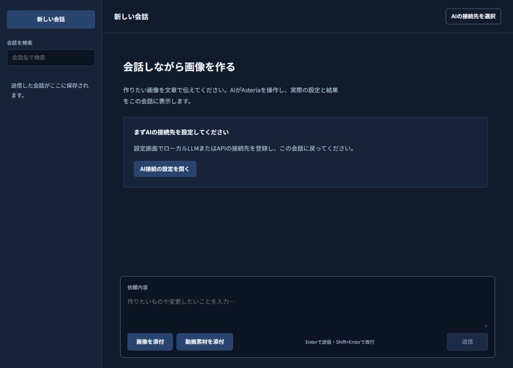

# AIチャット・MCP・LAN接続の使い方 / Assistant, MCP and LAN access

[日本語](#日本語) | [English](#english) | [README](../README.md)

## 日本語

V1.2.3では、**どこで操作したいか**によって入口を選べます。どの方法でも、作品を作るPCとAsteriaは起動したままにしてください。

| やりたいこと | 使うもの | 最初に用意するもの |
| --- | --- | --- |
| Asteriaの中でAIに頼み、結果を見ながら編集したい | AIチャット | ツール呼び出しに対応したローカルAI、またはAIサービスの接続先 |
| 普段使っている外部のチャットからAsteriaに頼みたい | MCP | 自分のAsteriaとMCP対応クライアントの接続設定。Webサービスから使う場合は認証付きの接続も必要 |
| 別のPC・スマートフォン・タブレットで、いつもの画面を直接操作したい | LAN接続 | 同じネットワークとブラウザー。AIの設定は不要 |

### AIチャット：最初の1枚を作る

1. Asteriaで「設定」→「AIプロバイダー」を開き、使うAIを追加して「AIプロバイダーを保存」を押します。ローカルAIを使う場合は、そのAPIサーバーも起動してください。**会話を担当するAI**と、Asteriaで**画像を描くモデル**は別々に選びます。
2. 「AIチャット」で「新しい会話」を開き、使うAIを選びます。「依頼内容」に **「Asteriaに入っている画像モデルを教えて。まだ生成しないで」** と入力して「送信」を押します。
3. 返ってきたモデル名を使い、**「そのモデルで、青い花の水彩画を1枚生成して」** と頼みます。生成が終わると、会話に画像が表示されます。プロンプトの文章だけを考えてほしい場合は「AIプロンプト支援」も使えます。

**一部だけ変えるには：** 会話の画像で「会話内で編集」を開き、変えたい部分をブラシで塗って「会話に反映」を押します。「会話に戻る」を押して **「塗った部分だけを赤い花に変えて」** と送信してください。マスクを保存しただけでは生成されません。「画像編集」画面で作業中の下書きは別に保持されます。手持ちの画像から始めるときは「画像を添付」を使えます。選択中のAIに画像が渡るのは依頼を送信した後です。

**自動リピートを止めるには：** 今の1枚を残すなら、生成中に「次回から停止」を押します。今の組が完了すると保存され、次の組は始まりません。「今の生成も停止」は処理中の組も止めます。「回答を停止」はAIの返事を止める操作で、受付済みの生成は続きます。通信が途切れて受け付けられたか分からない場合は、新しい依頼を送る前に「受付を確認して再送」を使ってください。

**同じ作品から再開するには：** **「履歴番号○○の設定を復元して。新しく生成はしないで」** と頼みます。動画や音楽なら **「保存済みの音楽を探して」** と頼み、作品を選ぶと会話内で再生できます。ファイルを残すには「ファイルを保存」を選びます。「会話の設定・管理」からのMarkdown・JSON書き出しには、作品本体ではなくメッセージと添付ファイルの情報が入ります。

### MCP：自分のチャットを自分のAsteriaにつなぐ

**MCPサーバーはAsteria本体に含まれます。** 利用者ごとにサーバーを開発したり、開発元のサーバーに登録したりする必要はありません。利用者が設定するのは、**自分が使う外部チャットから、自分のPCのAsteriaへの接続**です。Asteria内の「AIチャット」だけを使う場合、この作業は不要です。

- **同じPCのクライアント：** 「設定」→「外部連携」→「外部AIクライアントから使う（MCP）」で「MCP接続を許可」を押します。「Codex（TOML）」か「その他のローカルクライアント（JSON）」を選び、「設定をコピー」を押します。クライアントの設定には、既存の接続を残してAsteriaの項目だけを追加し、Asteriaと同じWindowsユーザーでクライアントを開き直します。ローカル接続にトンネルやLAN登録は不要です。
- **ChatGPTのWeb版など：** 同じMCP欄で「ChatGPTのWeb版などから使う場合」を開きます。WebサービスからはPC専用の設定を使えないため、[セキュアトンネルの公式手順](https://developers.openai.com/api/docs/guides/secure-mcp-tunnels)など、使うサービスに対応した方法で認証付きの接続を用意し、外部チャットに登録してください。Asteriaがトンネルを自動で作るわけではありません。LAN登録用QRやPCのローカルアドレスをそのまま登録したり、Asteriaのポートを直接インターネットに公開したりする必要はありません。

接続したら、まず **「保存済みの画像を1枚見せて。新しく生成しないで」** と試してください。画像を読めても、読み取り専用の接続では生成・停止はできません。外部チャットで表示される操作と権限を確認してください。音声・動画はクライアントによってプレーヤーではなくダウンロードリンクで渡されます。

### LAN：別の端末からいつものAsteriaを開く

1. 起動元のPCで「設定」→「外部連携」→「同じネットワークから使う」を開きます。「このPCの接続先」を選び、「LAN接続を開始」→「登録用URL・QRを表示」の順に押します。
2. 別の端末を同じネットワークにつなぎ、QRコードを読み取るか、登録用URLを開きます。「端末名」を入力して「この端末を登録」を押します。
3. 開いたAsteriaのページをブックマークします。**登録用URLは発行から24時間以内に1回使うもの**です。登録が済めば、同じブラウザーで毎回名前を入力したり、翌日に登録し直したりする必要はありません。別のブラウザーで使う場合や登録情報を消した場合は、新しい登録用URLを発行します。

通常のHTTP接続に証明書は不要です。信頼できる家庭内ネットワークで使ってください。使わなくなった端末は「登録済みの端末」から「登録を解除」できます。「LAN接続を停止」を押しても、受付済みの処理や保存した作品は消えません。

### 何が共有される？

画像・履歴・マスクなど、**Asteriaに保存したもの**は、別の入口からも呼び出せます。一方、外部チャットの会話や、別のブラウザーでまだ送っていないプロンプトまで同期されるわけではありません。AIチャット・MCPでは、画像生成・編集、動画・音楽生成、作品の確認などを頼めます。LoRAの学習やモデルのマージをする場合は、PCまたはLANから通常の画面を開いてください。

## English

Choose **where you want to work**. For all three options, leave the host PC and Asteria running.

| What you want to do | Use | What you need |
| --- | --- | --- |
| Ask an AI to create something and edit the result inside Asteria | Assistant | A local AI or API provider that supports tool calls |
| Use your usual external chat to operate your own Asteria | MCP | An MCP client connected to your installation; an authenticated route for a web service |
| Use the full interface directly on another PC, phone or tablet | LAN access | A browser on the same network; no AI setup |

### Assistant: make your first image

1. In Settings → AI Providers, add your AI and choose Save AI providers. For a local AI, start its API server as well. The AI that follows your instructions is separate from the image model that draws the picture.
2. In Assistant, start a New conversation and choose your AI. In Your request, enter **“Which image models are installed in Asteria? Don’t generate anything yet.”** Select Send.
3. Choose one of the models in the reply and ask, **“Use that model to generate one watercolor of blue flowers.”** Look for the finished image in the conversation. If you only want help wording a prompt, use AI Prompt Assist.

**Edit part of the image:** On the image, choose Edit in this conversation. Paint the area to change, select Apply to conversation, then Back to conversation. Send **“Replace only the painted area with red flowers.”** Applying the mask alone does not generate an image. The Image Edit workspace keeps a separate draft. To start from your own picture, use Attach images. It is shared with the selected AI only after you send the request.

**Stop automatic repeat:** Choose Stop after this batch to finish and save the current batch without starting another. Stop current generation and repeat also interrupts the current batch. Stop answer stops only the AI’s reply; accepted jobs continue. If the connection drops and you are unsure whether a request was accepted, use Check and resend before creating a new request.

**Return to a saved work:** Ask **“Restore the settings from history entry [number]. Don’t generate a new image.”** For video or music, ask for a saved work, select a match, and play it in the conversation. Use Download file to keep the media. Markdown or JSON exports under Conversation settings & management contain messages and attachment details, not the media files.

### MCP: connect your chat client to your own Asteria

**The MCP server is included in Asteria.** You do not build a server or register with a shared Asteria service. You configure a connection **from your external chat client to Asteria on your PC**. Skip this setup entirely if you only use the built-in Assistant.

- **Client on the same PC:** Open Settings → Integrations → Connect an external AI client (MCP) and choose Allow MCP connections. Select Codex (TOML) or Other local clients (JSON), then Copy settings. Add the Asteria entry without removing existing connections. Reopen the client as the same Windows user. No tunnel or LAN registration is needed.
- **ChatGPT Web or another online service:** In the same section, open Connect from ChatGPT Web or another online service. Follow the [official secure tunnel guide](https://developers.openai.com/api/docs/guides/secure-mcp-tunnels) or the authenticated connection method your service supports. Register that connection in the external chat. Asteria does not create the tunnel for you. The local client configuration, your PC’s loopback address and a LAN registration QR are not web-service endpoints. Do not expose the local Asteria port directly to the internet.

First ask, **“Show me one saved image. Don’t generate anything new.”** A read-only connection can retrieve work but cannot start or stop generation; check the tools your client actually offers. Audio and video may be delivered as download links rather than in-chat players.

### LAN: open the full interface on another device

1. On the host PC, open Settings → Integrations → Use Asteria on the same network. Choose This PC’s network address, then Start LAN access and Create a registration URL / QR.
2. On another device on the same network, scan the code or open the registration URL. Enter a Device name and choose Register this device.
3. Bookmark the Asteria page that opens. **Each invitation registers one browser within 24 hours of issue.** The registered browser does not need a name or a new invitation the next day. For another browser, or after clearing its registration, create a new URL.

Standard HTTP requires no certificate. Use it only on a trusted network. To disconnect a device, find it under Registered devices and choose Revoke access. Stop LAN access does not cancel accepted jobs or delete saved work.

### What is shared?

Images, history entries, masks and other items **saved in Asteria** can be retrieved through another interface. An external chat’s conversation and an unsent prompt in another browser do not automatically sync. Assistant and MCP can generate and edit images, generate video and music, and retrieve saved work. For LoRA training and model merging, open the ordinary interface on the host PC or over LAN.
