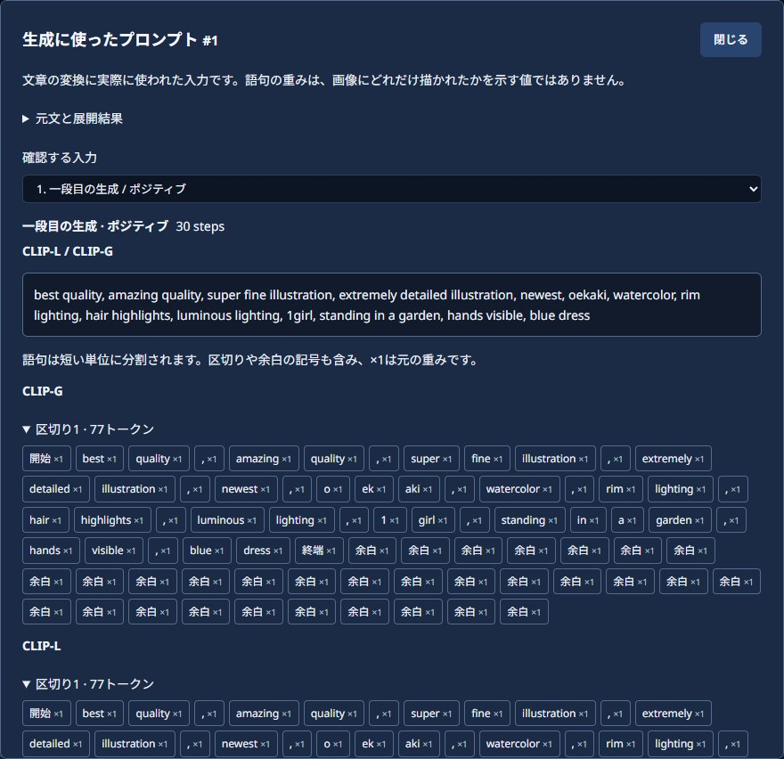
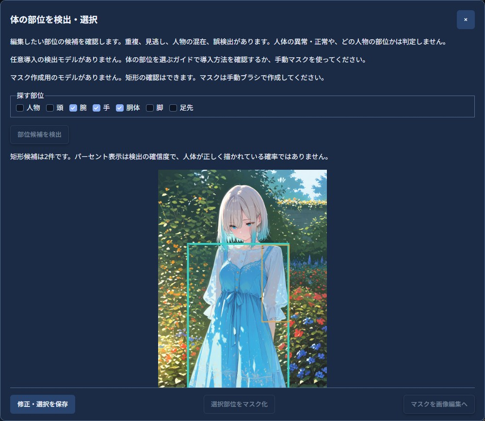
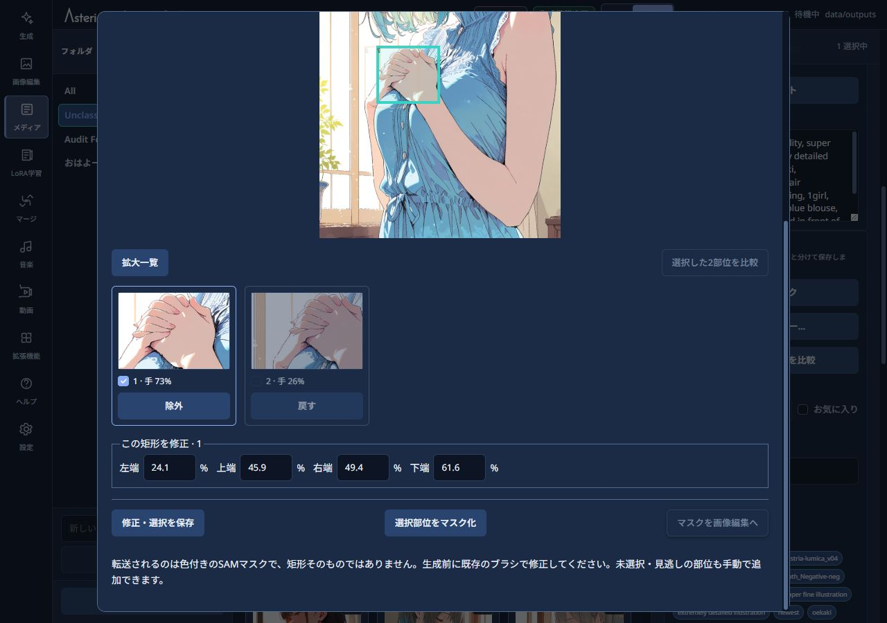
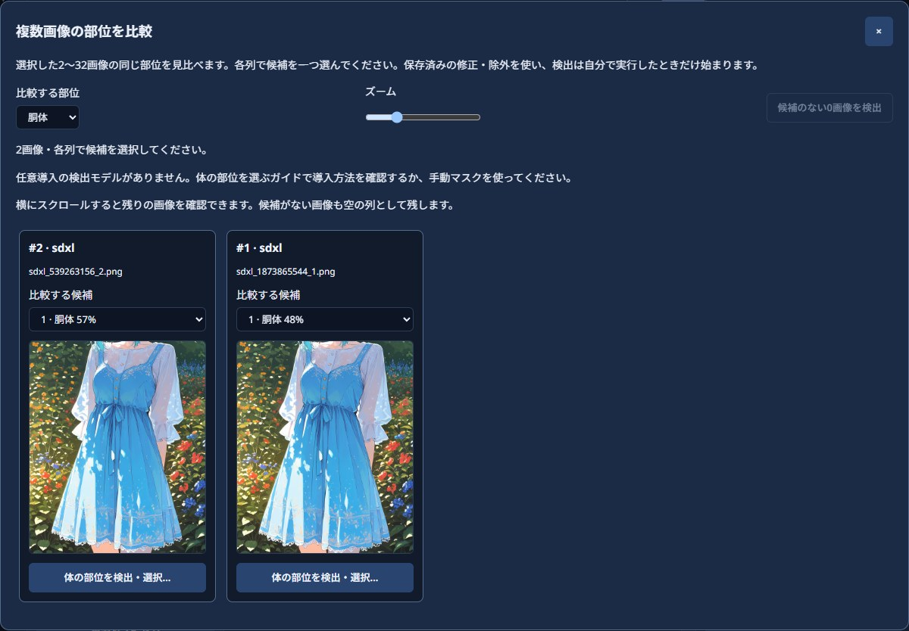
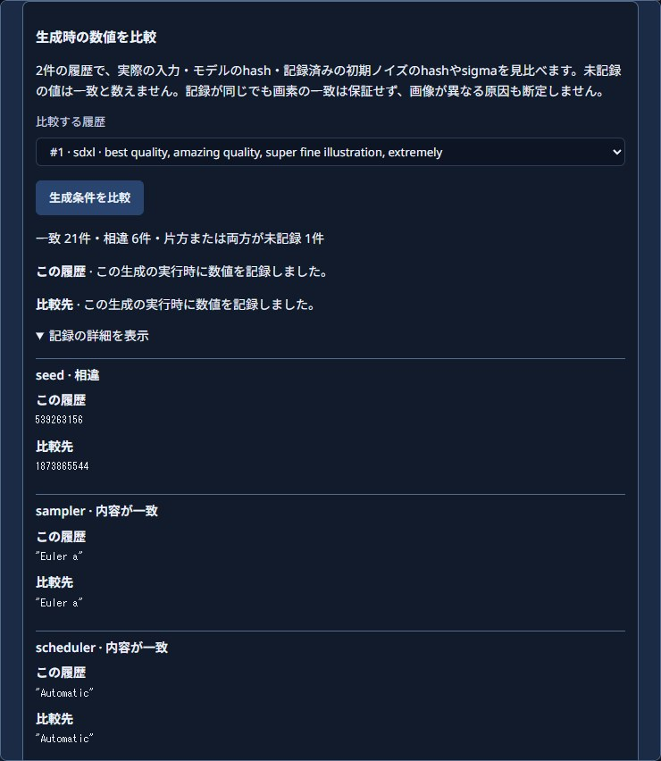

# プロンプト・生成過程・画像の制作支援 / Creative workflows

[日本語](#日本語) | [English](#english) | [README](../README.md)

## 日本語

このガイドでは、生成、メディアライブラリ、LoRA学習の制作支援を説明します。目的に合う項目から読んでください。

AIへ依頼する機能は、先に設定画面で接続先を用意してください。画像の確認には画像対応モデルが必要です。外部の接続先を選ぶと、画面に示された文章や画像がPCの外へ送られます。

モデルが多い場合は、Generate上部の「モデルを検索」で名前やフォルダー名を絞り込めます。検索語を変えても、選択中のモデルは保持します。「詳細スタイル」のカードで省略された名称は、選択後の詳細欄で全文を確認してください。

### 1. プロンプトを組み立てる

Generateの「AIプロンプト作成」では、描きたい場面を日本語などで説明し、ベース・キャラクター・詳細に分けたプロンプト案を作れます。

1. AI接続先を選び、「描きたい場面」と任意の入れたい特徴や語句を入力します。
2. 「プロンプトを提案」を押し、各項目とネガティブの案を確認・編集します。
3. 「三つの欄へ反映」でポジティブを置き換えます。ネガティブも置き換える場合は、その選択をONにします。

反映すると項目別入力に切り替わります。欄の名前と順序は保ち、ワイルドカードの固定は解除します。AIへ依頼しただけでは、入力中の文章は変わりません。

「保存プロンプト」では人物・衣装・ポーズ・背景などの文章に名前を付けて保存できます。使う順に選び、「この欄へ追加」で入力欄の末尾へ追加します。LoRAやEmbeddingのひも付けも適用するか選べます。「AIプロンプト作成へ渡す」では文章だけを提案に使い、ひも付けた資産を自動適用しません。

画像から保存プロンプトの候補を作る場合は、見える特徴と候補の文章を見比べてから保存してください。同じ人物や指定した配置を再現する保証はありません。

詳細スタイルも、保存した文章の再利用に使えます。保存プロンプトは入力欄へ文章を追加して編集する方法、詳細スタイルは選んだ文章を生成時に適用する方法です。どちらもLoRAやEmbeddingの記法を使えます。保存プロンプトでは、それらの関連付けを別の設定として管理することもできます。

「AIで矛盾確認」は、人数・髪・服・動作などの文章が食い違う可能性を示します。別人物の説明や意図した変化もあるため、候補を見て判断してください。文章を勝手に削除・修正する機能ではありません。

### 2. ワイルドカードを部分固定する

Wildcardsの「ツールを開く」から「展開プレビュー」を使うと、今回選ばれた候補を確認できます。髪色だけ固定したい場合は、その選択だけを固定してください。固定していない髪型や衣装は、次の生成でも選び直されます。

入れ子の候補は、外側と内側で選択が分かれます。外側だけの固定と、展開された文章全体の固定は同じではありません。必要な選択をそれぞれ確認してください。元のプロンプトや候補ファイルが変わり、固定を引き継げなくなった場合は、展開プレビューを作り直します。

ワイルドカードのファイルは利用者が用意します。自分のファイルを共有せずに、項目別入力や通常の候補記法だけを使うこともできます。

### 3. 解釈を確認し、語句の効果を比べる

生成結果の「生成に使ったプロンプト」では、元文と展開後の文章、重み、記法が適用される時期、モデルの文章変換に使った入力を確認できます。HiresやDetailerなど、記録のある段階も選べます。語句の重みは、画像に描かれた強さの測定値ではありません。入力記録のない過去の画像から、後付けで取得することもできません。

「プロンプトの比較生成」では、語句・ネガティブ・LoRA・Embedding・一欄の文章・スタイルのうち一つを変えて比べます。

1. 変更する対象とBの値、比較する組数を指定します。
2. 「比較内容を確認」で、実際に使う文章と設定を確認します。
3. 「比較を開始」で生成し、二枚が完成した組を評価します。

一組のAとBは同じSeedを使います。初期ノイズの差を除いて、変更した入力の影響を比べるためです。Seedが`-1`なら準備時に一度抽選します。一組で二枚、バッチサイズ1の比較です。

結果では条件名を隠して「左の画像」「右の画像」「差を感じない」「どちらも選ばない」を選び、メモとともに保存できます。後から条件を表示することもできます。好みの比較であり、少数の画像で効果や成功率を証明する機能ではありません。

### 4. 自動生成を指定した条件で終了する

「自動リピート」をONにし、「終了条件」から最大試行枚数・最大時間・合格枚数を指定します。初期値は三つとも`0`で、その条件の上限なしを意味します。以前に保存した値は引き継ぎます。合格枚数を使うには「身体チェック」をONにしてください。

失敗や不合格も試行枚数に含みます。上限に達した場合は実行中の一枚を終えてから停止し、理由を表示します。接続エラーや判定不能を合格として数えることはありません。ブラウザーを閉じたり処理を中止したりした後に、自動で生成を再開する機能ではありません。

### 5. 補正前後と生成過程を保存する

Generateの「補正・拡張」では、必要な記録だけをONにできます。保存先は通常の生成画像と共通です。

| 選択 | 保存するもの | 注意点 |
|---|---|---|
| 補正前後の画像を保存 | 一段目、Hires、Topaz、Detailerなど実際の処理前後の画像 | 画像への変換時間と保存容量が増えます |
| 生成過程を動画で保存 | 途中プレビューから作るMP4とGIF | 画像モデルの計算は増えませんが、動画の作成時間と保存容量が必要です |
| 生成の途中状態を保存 | 指定した一つのステップの再開用データ | 一枚あたり最大128MiB。対応する生成で利用します |
| 言葉で選ぶ範囲を記録 | 語句の参照範囲の候補 | 処理時間と保存容量が増え、正確な部位の輪郭とは限りません |

比較用画像はMedia Libraryで並べて確認できます。画素が変わった場所と、顔や服の意味が変わったかどうかは分けて確認してください。生成過程の動画は実際に取得できたプレビューを使うため、すべてのステップが必ず収録されるわけではありません。中止や身体チェック不合格の場合は動画を残しません。

途中状態を保存した結果では、「ステップ○から続きを生成…」から続きのプロンプトやCFGを変え、別の候補を作れます。元の画像と履歴は残ります。元のモデル・Seed・サイズなど、再開時に固定される設定は変更できません。後半の分岐では、構図などを大きく変える効果は弱くなる場合があります。

途中からの再開は、単一画像のSDXL／Animaのtxt2imgと、Euler、Euler a、DPM++ 2M、DPM++ 2M SDE、DPM++ 3M SDE、ER SDEに対応します。保存するステップは一段目の終了やRefinerへの切り替えより前にしてください。利用できない条件は画面で確認できます。

ControlNetやAnima LLLiteを併用した場合は、制御画像とマスクも途中状態に保存します。元の画像ファイルを変更・削除しても、再開には保存時の画像を使います。保存したコピーが変更・削除された場合は再開できません。制御画像も一枚あたり最大128MiBの保存量に含まれます。

### 6. 完成画像を確認して再利用する

Media Libraryの「AIで画像の条件確認」では、人数、髪・服、背景、行動、見切れ、不要物などを一行に一つ指定します。画像対応AIの結果は「一致」「不一致」「不明」です。見えない部分は不明として扱い、誤った結果は理由を添えて訂正できます。最新の判定で一覧を絞り込めます。画像を変更・削除する機能ではなく、人体の崩れ判定とも別です。

「AIで見た目を比較」では、基準画像と比較する画像を選び、髪・服・顔などの変化を確認します。二枚から24枚まで扱えます。AIの元の結果と利用者の訂正を残します。同一人物の生成を保証する機能ではありません。

「生成設定の復元・比較」では、保存した文章や設定に加え、当時のモデルと現在のモデルの違いを確認して再利用できます。資産の欠落や変更があれば、対応するものを選び直してください。設定を復元できても、モデルや実行環境が違えば同じ画素になるとは限りません。

画像生成のSeed／Subseed欄には、`-1`（ランダム）か、`0`〜`9,007,199,254,740,991`の整数を使ってください。ブラウザーで正確に扱えない値は、丸めたまま送信せずエラーで停止します。これは入力欄の制約であり、過去の記録やbackendのSeedを書き換えるものではありません。

「完成画像の身体チェック」は、通常生成・Hires.fix・Topaz・ADetailerなど、すべての生成・補正が終わった完成画像に対して、正式な保存・履歴登録・表示の前に一回実施します。[身体チェックのガイド](IMAGE_CHECK.md)を参照してください。AIには見逃しや誤判定があります。独自の人体判定器は現在選べません。

### 7. 語句の範囲を部分編集へ渡す・複数人のポーズを作る

語句の参照範囲を記録した画像では、「髪」「服」などの語句を選び、範囲の候補を確認できます。そのまま正確な部位マスクとは考えず、ブラシで追加・削除してから部分編集へ渡してください。Hires後の画像にも合う大きさで編集します。

画像編集のポーズ画面では人物を追加し、関節をドラッグして姿勢を変えます。「人物全体を移動」では身体をまとめて動かせます。生成へ渡す制御画像には、選択中以外の人物も全員入ります。対象ごとの完成画像を合成する機能ではありません。

SDXLでは対応するControlNet、Animaでは対応するLLLiteと制御画像を使います。必要なモデルは利用者が用意してください。AnimaのLLLiteは制御画像が結果に作用しても、任意のポーズに追従するとは限りません。ポーズや複数人の描き分けを保証する機能ではありません。

### 体の部位を見比べて編集する

「体の部位を検出・選択」では、検出候補を拡大して確認し、必要な範囲を編集へ渡せます。人体の正常性や部位の所属は判定しません。

1. メディアライブラリの画像詳細、または画像編集のマスク欄で「体の部位を検出・選択」を開きます。
2. 「探す部位」を選び、「部位候補を検出」を押します。
3. 画像上の矩形と拡大一覧を確認します。候補には重複・誤検出・見逃し・人物の混在があります。

候補の画像を押すと、その矩形の端を修正できます。不要な候補は「除外」で外し、「戻す」で復帰できます。「修正・選択を保存」で次回にも残します。二つ選ぶと同じ表示部品で拡大比較できます。マスク化は一度に16部位までです。

複数画像の同じ部位を見る場合は、メディアライブラリでCtrl＋クリック、またはCtrl＋Enterで2〜32画像を選び、「部位を比較」を開きます。「手」などの種類を選び、各画像から一候補を選ぶと、切り出した部位を横並びで比較できます。拡大率は共通です。横へスクロールすると残りの画像も確認できます。候補のない画像も空欄として残ります。必要なら「候補のない○画像を検出」を押してください。○には対象の画像数が表示され、押したときだけ検出が始まります。各列の「体の部位を検出・選択」で候補の修正・除外や既存のマスク編集へ進めます。

SAMが利用できる場合は「選択部位をマスク化」を押し、色付きの実マスクを確認して「マスクを画像編集へ」を使います。矩形だけの候補をマスクとして転送することはありません。Image Editのブラシ・消しゴムで修正し、既存の「マスクを保存」から生成へ進んでください。未保存の手動マスクがある場合は先に保存します。元画像は上書きしません。

検出とマスク作成は任意導入で、利用者が操作したときだけCPUで実行します。モデルがなければ対応ボタンが無効になりますが、手動編集は使えます。[Grounding DINO tiny](https://huggingface.co/IDEA-Research/grounding-dino-tiny/tree/a2bb814dd30d776dcf7e30523b00659f4f141c71)のモデル・設定・tokenizerをモデル保存先の`body_review/grounding-dino-tiny/`へ、[SAM ViT-B](https://github.com/facebookresearch/segment-anything#model-checkpoints)を`sams/sam_vit_b_01ec64.pth`へ配置してください。AsteriaのPython環境にはTransformersとsegment-anythingも必要です。両モデルはApache-2.0ですが、提供元の利用条件も確認してください。モデルの自動取得は行いません。

### 再生成条件の差を調べる

「生成設定の復元・比較」→「生成時の数値を比較」を開きます。比較する履歴を選び、「生成条件を比較」を押してください。

Seed、Sampler、実際の入力、モデル・VAE・Embedding等の記録済みhashを比較します。今後の通常生成では、実際に使ったsigma列、初期noiseと入力latentのhash、入力の配置先、samplingの計算先も記録します。Hires等の工程やbatchも分けて確認できます。tensor本体は保存しません。

対応する実行経路で取得できた値だけを表示します。1tensorが16MiBを超える場合のhashや、合計512KiBの記録上限を超えた分は省略します。過去の欠損を推測で補わず「未記録」のままにします。runtimeの計算結果を再利用した場合は、その記録も再利用と表示し、今回新しくsamplingした値とは区別します。記録の一致は画素一致や相違の原因を保証しません。通常生成の計算方式・乱数・再生成処理は変更しません。

### 8. LoRAの素材と実用性を点検する

LoRA学習では、学習画像とcaptionの対応、トリガー、特徴の偏り、似た画像や混入候補を確認できます。画像対応AIの注釈は確認用の候補です。既存captionを自動で置き換えたり、この確認だけで学習を始めたりしません。

キャラクター学習では、全captionの先頭へトリガーを置きます。トリガーに覚えさせる固定特徴はcaptionから外し、変化する服・姿勢・表情・背景・小物・照明を残してください。

学習後の「LoRAあり・なしを比較」では、服・背景・ポーズなどの場面を変えて生成できます。同じ組は同じSeedで生成し、人物の特徴、服、背景、姿勢、画質などを別々に評価して記録します。学習中のLossが下がっただけで完成とは扱わず、学習に使っていない条件でも画像を確認してください。

## English

These tools are available in Generate, Media Library, and LoRA Training. Start with the section that matches your task.

Configure an AI connection in Settings before using AI-assisted actions. Image reviews require a vision-capable model. An external connection receives the text or images described on the screen outside your PC.

Use Search models at the top of Generate to filter a large model list by model or folder name. Editing the search keeps the selected model. Select an Advanced Style to read its full name in the detail panel when the card shortens it.

### 1. Assemble prompts

AI prompt builder turns a scene description and optional Details to include into Base, Character, Details, and negative-prompt suggestions. Choose an AI connection, request a proposal, and review or edit it before applying it. Applying replaces the three positive sections and switches to sectioned input, while preserving their names and order. Negative replacement is optional. Pinned wildcard choices are cleared. Requesting a proposal alone never changes your current text.

Use **Saved prompts** to store reusable text for people, outfits, poses and backgrounds. Select entries in order and append their text to the end of a prompt field. You can also apply linked LoRA and Embeddings. **Use in AI prompt builder** sends only the selected text for a suggestion; it does not apply linked assets. Review image-derived suggestions against the visible image before saving them. Saved prompts do not guarantee identity or placement.

Advanced Styles also reuse saved text. With **Saved prompts**, you append editable text to an input field; with **Advanced Styles**, you apply selected text during generation. Both can contain LoRA or Embedding syntax. Saved prompts additionally lets you manage those links as separate settings.

AI conflict check suggests possible conflicts in count, appearance, clothing, or actions. Different subjects and intentional changes can look contradictory, so review the suggestions yourself. It never deletes or rewrites your prompts.

### 2. Pin individual wildcard choices

Open the Wildcards tool and prepare an expansion preview. Pin only the choices you want to keep, such as hair color; unpinned hair styles and clothing are rerolled. Nested choices have separate outer and inner selections, so pinning the outer choice does not necessarily freeze its entire expanded text. Review each relevant choice. If changes to the prompt or candidate files invalidate a pin, prepare a new preview.

Supply your own wildcard files. The ordinary three-section editor and prompt-alternative notation also work without sharing or installing personal wildcard files.

### 3. Inspect interpretation and compare effects

Open **Prompts used for generation** to inspect original and expanded text, weights, notation timing, and recorded text-encoder input. Recorded Hires and Detailer stages are selectable. A weight is not a measurement of how prominently a phrase appears in the image. Results without an input record cannot acquire it retrospectively.

Use **Generate a prompt comparison** to change one phrase, negative input, LoRA, Embedding, section, or style. Select the change and pair count, review the prepared inputs, then start the comparison. Each pair uses the same Seed for A and B to isolate the change from initial-noise differences. Seed `-1` draws seeds once during preparation. Each pair produces two images at batch size one.

You can vote for the left or right image, choose no preference or neither, and save notes before revealing the conditions. This is a preference aid, not a statistical proof of effectiveness or success rate.

### 4. Set automatic-generation limits

Enable automatic repeat and open its stop conditions. Set limits for attempted images, elapsed time, or accepted images. All three default to `0`, meaning no limit for that condition; previously saved values are retained. Accepted-image limits require **Check anatomy**. Failed and rejected images count toward attempts. When a limit is reached, Asteria finishes the current image and shows the stop reason. Unknown judgments and connection errors are not accepted images. Closing the browser or interrupting the run does not schedule an automatic restart.

### 5. Record stages and generation progress

In Generate's enhancement settings, independently enable **Save images before and after enhancement**, **Save a video of generation progress**, **Save an intermediate generation state**, or word-reference maps. All use the common generation output folder.

Stage images add decoding and disk costs. The generation video uses captured previews without extra image-model evaluations, but needs encoding time and storage; some steps may be absent. It is not retained for cancelled or anatomy-check-rejected runs. A branch state uses up to 128 MiB per image. Word-reference maps add processing and storage and are not exact object boundaries.

Compare stage images in Media Library, distinguishing pixel changes from semantic changes to faces or outfits. Saved branch states expose a branch action on the result. Edit continuation text or CFG to create another candidate while retaining the original image and history. Settings fixed by the saved state, such as its model, Seed, and dimensions, cannot be changed. Late branching may have little effect on composition.

Branching supports single-image SDXL/Anima txt2img with Euler, Euler a, DPM++ 2M, DPM++ 2M SDE, DPM++ 3M SDE, and ER SDE. Capture before the first pass ends or switches to a Refiner. The screen explains unavailable conditions.

With ControlNet or Anima LLLite enabled, the saved state also retains control images and masks. Branching uses these saved copies even if the original files change or are deleted. A modified or missing saved copy prevents replay. Control images count toward the 128 MiB limit per image.

### 6. Review and reuse completed images

**Check image conditions with AI** in Media Library accepts one criterion per line, such as count, hair, clothing, background, action, cropping, or unwanted objects. A vision model reports match, mismatch, or unknown; invisible details remain unknown. Correct a judgment with a reason and filter the library by its latest result. This does not change or delete the image and is separate from anatomy checking.

**Compare appearance with AI** compares two to 24 images against a reference for changes in appearance, clothing, or faces. Original AI judgments and your corrections are retained. It does not guarantee that generated images depict the same identity.

**Restore and compare generation settings** restores recorded text and settings and checks recorded assets against currently available ones. Reselect missing or changed assets. Restored settings do not guarantee pixel-identical output across different models or execution environments.

For the image-generation Seed and Subseed fields, use `-1` for random or a whole number from `0` to `9,007,199,254,740,991`. Values that the browser cannot represent exactly are refused instead of being rounded and submitted. This is an input-field limitation; it does not rewrite existing records or backend Seeds.

Anatomy checking runs once after all generation and enhancement steps, including ordinary generation, Hires.fix, Topaz, and ADetailer, on the completed image before its official save, history registration, and display. See [Image checks](IMAGE_CHECK.md). AI can miss problems or give false alarms. A native anatomy checker is not currently selectable.

### 7. Use word maps and multi-person poses

Images with recorded word-reference maps can suggest edit regions for words such as hair or clothing. Refine the region with add/remove brush strokes before sending it to inpaint. Do not treat it as an exact segmentation mask. Editing uses the image's final size, including Hires output.

In the pose editor, add people and drag their joints or move an entire person. One control image includes every person, not just the selected one; this is not a composition of separately generated people. Use a compatible SDXL ControlNet or Anima LLLite model and supply the required weights yourself. Anima LLLite can influence the result without following an arbitrary pose. Pose following and multi-person attribute separation are not guaranteed.

### Inspect body parts and send them to editing

Use **Detect and select body parts** to inspect enlarged candidates and send selected regions to editing. It does not judge anatomical correctness or person ownership.

1. Open **Detect and select body parts** in Media Library image details or the Image Edit mask inspector.
2. Select the parts to look for and press **Find candidates**.
3. Inspect the box overlays and enlarged crops. Duplicates, false detections, missing parts and mixed people may remain.

Click a crop to adjust its box edges. Exclude or restore candidates, and use **Save review** to retain corrections and selections. Select two crops for comparison using the shared image viewer. Up to 16 selected regions can be masked at once.

For the same part across multiple images, select 2–32 Media Library images using Ctrl+click or Ctrl+Enter, then open **Compare body parts**. Choose a part type and one candidate per image. Crops appear side by side with shared zoom; scroll horizontally to reach the other images. Missing candidates remain as empty columns. If needed, click **Detect missing candidates (… images)**; the label shows the number of affected images, and detection starts only when clicked. Each column's **Detect and select body parts** reuses the existing correction, exclusion and mask-editing workflow.

When SAM is available, create a mask and inspect its colored area before sending it to Image Edit. Rectangles are never presented as segmentation masks. Refine the real mask with the existing brush/eraser, save it, then continue through Generate. Save an unsaved manual mask before opening another review. Original images are not overwritten.

Detection and masking are optional, CPU-only and explicitly invoked; they do not run after each generation. Missing models disable only their respective operations, not manual editing. Put the pinned [Grounding DINO tiny](https://huggingface.co/IDEA-Research/grounding-dino-tiny/tree/a2bb814dd30d776dcf7e30523b00659f4f141c71) model/config/tokenizer files in `body_review/grounding-dino-tiny/` under model storage, and the official [SAM ViT-B](https://github.com/facebookresearch/segment-anything#model-checkpoints) checkpoint in `sams/sam_vit_b_01ec64.pth`. Asteria's Python environment also needs Transformers and segment-anything. Both models declare Apache-2.0; check their provider terms. Models are not downloaded automatically.

### Inspect recorded regeneration differences

Open **Restore and compare generation settings → Compare recorded generation values**, choose another history entry, then press **Compare generation conditions**.

The comparison shows saved inputs, Seed, Sampler and model/VAE/Embedding hashes. Future ordinary generations also record actual sigma values, initial noise and input-latent hashes, input devices and sampling compute devices. Hires stages and batches remain distinct. Tensors themselves are not saved.

Only observed values from supported execution paths are displayed. Hashing is skipped above 16 MiB per tensor, and records are bounded to 512 KiB in total. Missing historical values stay **Not recorded** rather than being reconstructed. Reused runtime results are labeled as reused observations, not fresh sampling. Matching records do not guarantee identical pixels or establish the cause of a difference. Ordinary generation arithmetic, RNG and regeneration behavior are unchanged.

### 8. Review LoRA data and practical behavior

LoRA dataset review checks image/caption correspondence, triggers, feature distribution, similar images, and possible unrelated content. Vision-model annotations are suggestions. They do not automatically replace captions or start training. For character training, put the trigger first in every caption, omit stable features that the trigger should recall, and retain variable clothing, pose, expression, background, props, and lighting.

After training, practical comparisons generate LoRA-on/off images across different outfits, backgrounds, and poses. Each pair shares a Seed. Record identity features, clothing, background, pose, and quality separately, and inspect conditions not used for training. A lower training Loss alone is not evidence of practical success.
