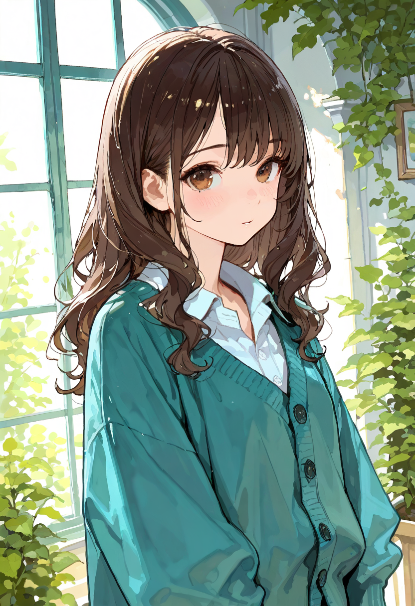
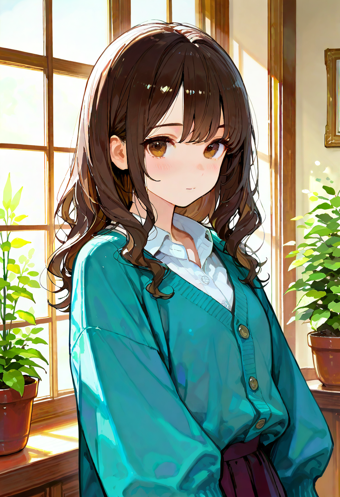
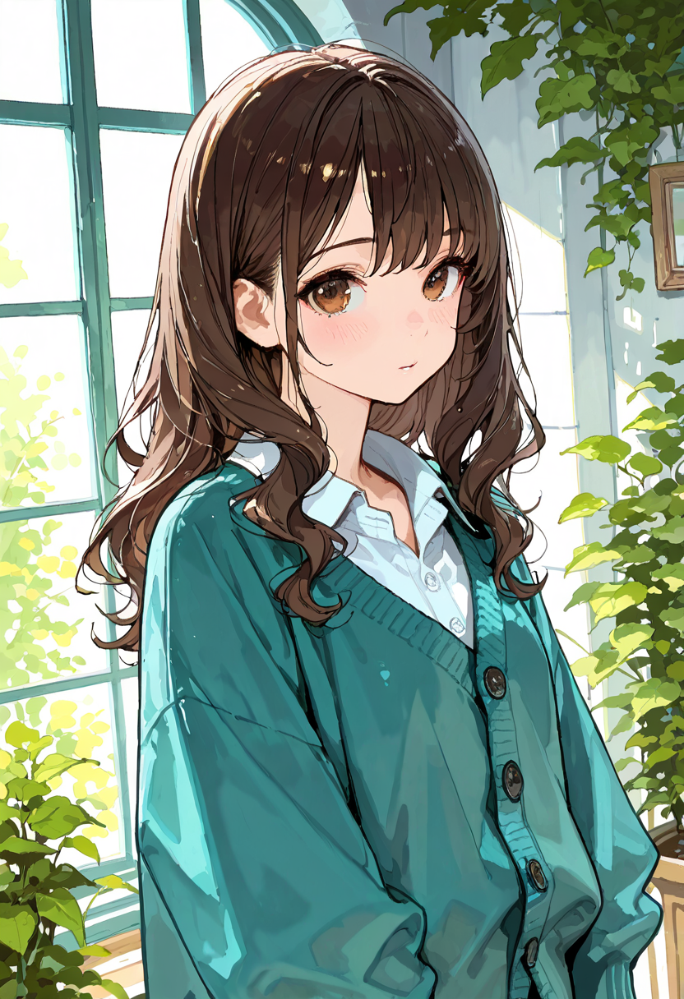
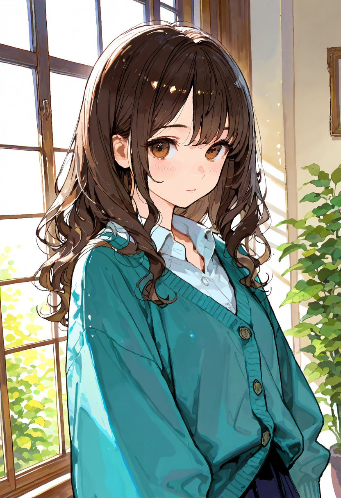
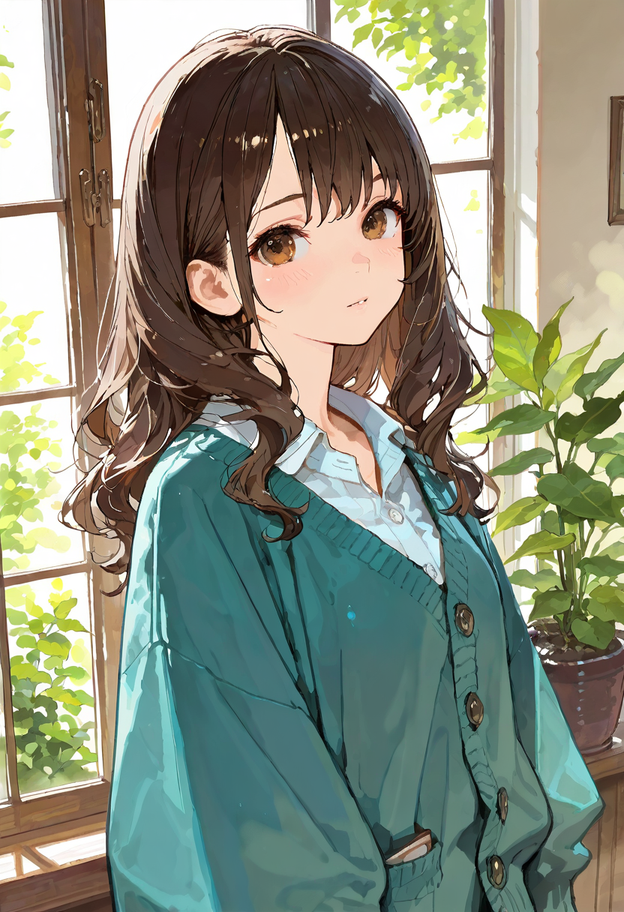
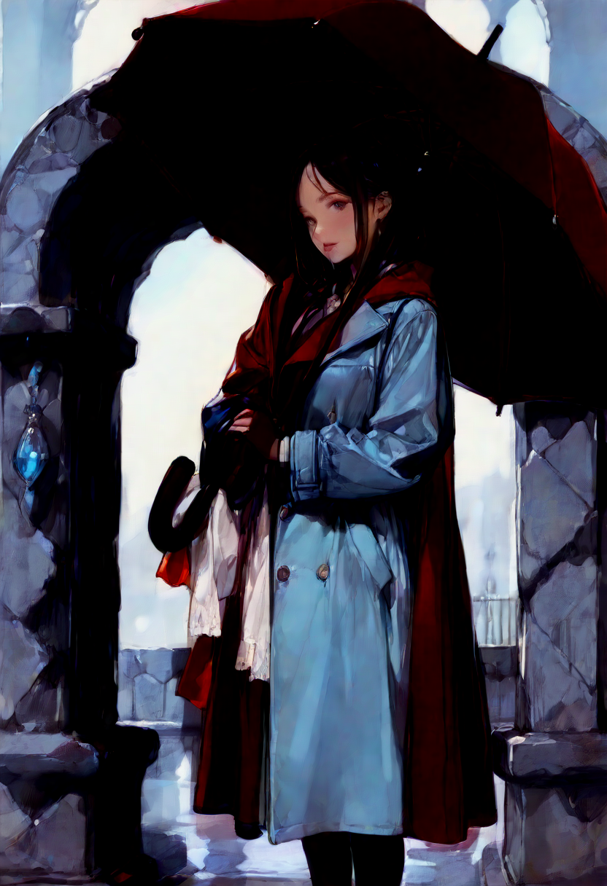
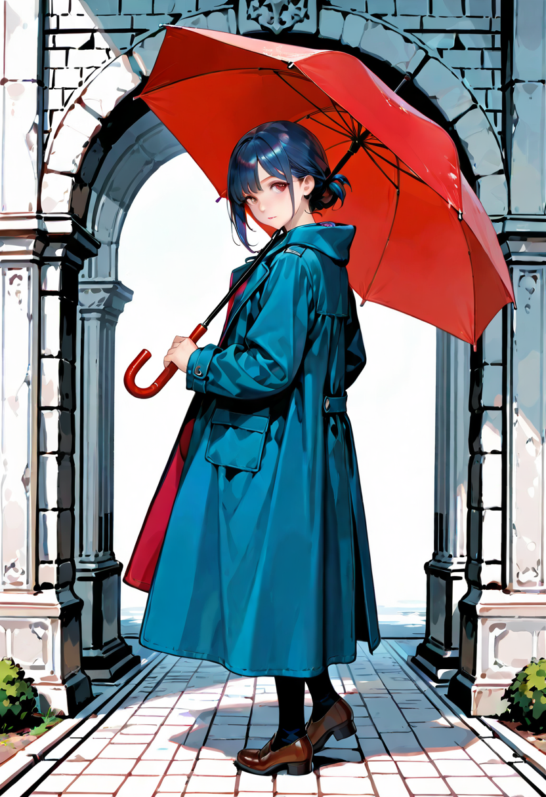
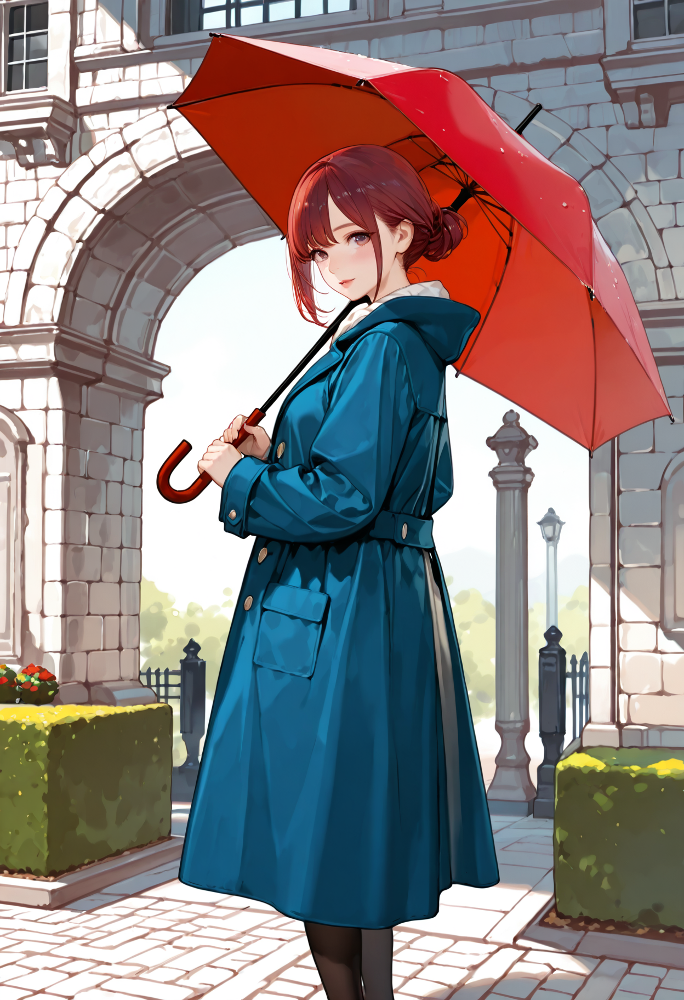
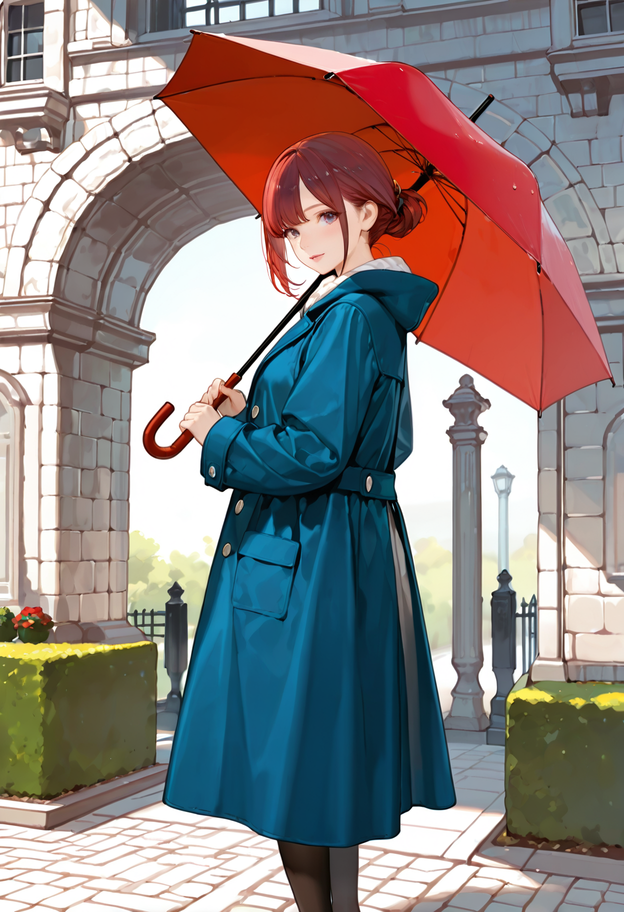

# 人物作例で見る生成オプション6種

[English](#english) · [READMEに戻る](../README.md)

同じモデル、同じプロンプト、同じSeedでも、生成の途中で何を重視するかによって仕上がりは変わります。下の表から、今の画像で変えてみたいところを選んでください。すでに気に入った画像を出せているなら、どれもオンにする必要はありません。

| こんなときに | 試す機能 | 作例で見比べるところ |
| --- | --- | --- |
| 服と背景が似た調子に見える。明暗や質感に変化がほしい | [FreeU V2](#freeu-v2) | カーディガンの青緑と窓枠の色 |
| 今の絵で、髪や輪郭の描写を少し変えてみたい | [SAG](#sag) | 毛先、袖の縁、窓の外の葉 |
| CFGを上げたら服の色が強くなりすぎた | [APG](#apg) | 服の色と、顔・肩の向き |
| 同じ文章から、別の特徴や構図を引き出したい | [ReGA](#rega) | 指定した「赤い傘」がどう描かれたか |
| 同じ人物と小物で、形やポーズの別案がほしい | [SSG](#ssg) | 人物が足元まで入るか、アーチの輪郭 |
| 元の構図を生かして、大きな画像の細部を描き直したい | [HiWave](#hiwave) | 傘を持つ指、襟、石の模様 |

**試し方：** 「生成」→「生成設定を開く」で機能を選びます。SDXLのFreeU V2とSAGは「FreeU / SAG」にあります。他モデルのSAG、APG、ReGA、SSGはそれぞれの名前から開きます。まずSeedを固定してオフで1枚生成し、ほかの設定は変えずに試したい機能だけをオンにして、もう1枚生成してください。最初の5機能はHires.fixなしでも使えます。HiWaveだけは拡大の描き直しに使います。

**作例の読み方：** 左が基準、右が適用後です。すべてSDXL、Seed `2052206899`、832 × 1216、Euler a / Karras、Clip skip 2、LoRAなしで生成しました。窓辺の人物と、石のアーチの下で傘を持つ人物の2種類を使い、各組ではプロンプトも固定しています。画像を開くと元の解像度で見比べられます。モデルやSeedを変えれば、違いの出方も変わります。

**対応モデル：** FreeU V2はSDXL専用です。SAG・APG・ReGA・SSG・HiWaveは、SDXLのほか、Anima、MOSS-Image SFT、Krea 2 Turbo、FLUX.1、FLUX.2でも使えます。同じ数値が別のモデルでもちょうどよいとは限りません。特にReGAとSSGは、モデルを替えたらそのモデルの初期値から試すと比較しやすくなります。

### FreeU V2

**全体の形と明暗のバランスを変えます。** 鉛筆画で、輪郭線をなぞり直すのではなく、服と背景の陰の置き方を変えるようなものです。B1・B2は形を組み立てる特徴、S1・S2は途中から引き継ぐ大まかな明暗を調整します。

| オフ | FreeU V2 オン |
| --- | --- |
|  |  |

30ステップ、CFG 6.5。右は **B1 1.3・B2 1.4・S1 0.9・S2 0.2**。窓枠に暖色が出て、青緑の服が背景から浮いて見えます。全体を一律にシャープにする機能ではありません。**SDXL専用**です。他のモデルには、この方式が調整する経路がありません。

### SAG

**モデルが注目した部分を手掛かりに、描写を補います。** 生成途中の注目箇所を一度ぼかして、元の予測と見比べ、その差を次の描写に使います。完成画像にぼかしをかける機能ではありません。

| オフ | SAG オン |
| --- | --- |
|  |  |

30ステップ、CFG 6.5。右は **補助の強さ（Scale）0.5、ぼかし幅（Blur Sigma）2**。FreeU V2と同じ左画像ですが、こちらは服の色よりも毛先や袖の縁に違いが出ました。「補助の強さ」が0なら補正はかかりません。「ぼかし幅」には0より大きい値を使います。追加の計算が入るので、時間がかかることがあります。

### APG

**プロンプトを強く効かせたときに、色まで強く出すぎるのを抑えます。** CFGは、文章に沿うように生成をどれだけ誘導するかを決める値です。APGは完成後に彩度を下げるのではなく、生成途中の誘導のかけ方を変えます。

| オフ（CFG 8） | APG オン（CFG 8） |
| --- | --- |
|  |  |

24ステップ。右は **平行成分の強さ（η）0、補正量の上限0、モメンタム0**。同じCFGでも服の色や明るい背景の見え方が変わり、ポーズも少し変わりました。**CFG 1ではAPGをオンにしても画像は変わりません。** Krea 2でCFG 1を使っている場合も同じです。FLUXでは、この条件に関係するのはDistilled CFGではなく **True CFG** です。効果を比べるときは、オフ側もオン側も同じCFGにしてください。

### ReGA

**文章のどの特徴に注目するかを変え、別の描き方を引き出します。** 同じ「青いコート、赤い傘」という注文でも、コート・傘・人物のどれが絵の中心になるかが変わり得ます。指定した単語だけを正確に強める機能ではありません。

| オフ | ReGA オン |
| --- | --- |
|  |  |

24ステップ、CFG 8。右は **強調の強さ10、補正を使うステップの割合0.52**（序盤の約半分）。傘が目立つ構図になった一方、指定した赤はむしろ弱まりました。**Animaでは、まず割合を空欄にしてモデルの初期値0.04で**試してください。SDXLと同じ0.52を試したAnimaの2例では、人物が消えて縞状のノイズになりました。元の生成と比べるにはReGA自体をオフにします。「強調の強さ」を0にしても、注目する語の選び方は元に戻りません。

### SSG

**形や細部の組み立て方を変えます。** モデルが扱う画像の特徴を一部入れ替えてもう一つの予測を作り、元の予測との差を描画に使います。同じ被写体を、少し引いた構図や違うポーズで描き直すこともあります。手だけ、顔だけを修正する機能ではありません。

| オフ | SSG オン |
| --- | --- |
|  |  |

24ステップ、CFG 8。右は **補正の強さ3、入れ替える特徴の割合0.2**。赤い傘を残しながら、足元まで収まる構図に変わりました。**強さ3はSDXLの初期値です。** Animaでこの値を使った2例はほぼ真っ黒になり、モデルの初期値0.15では人物と傘が見えました。Anima・MOSS-Image・Krea 2・FLUXでは0.15から試せます。強さか割合のどちらかを0にすると補正はかかりません。

### HiWave

**元画像を大きくしたあと、重なり合う小さな領域ごとに細部を描き直します。** 写真をただ引き伸ばすのとは違い、指や服の縁に新しい線が入ることがあります。操作は「生成設定を開く」→「Hires.fix」→「有効化」→「Hires詳細設定」→「Hires sampler」で **HiWave** を選びます。

| 通常のHires（HiWaveなし） | 同じ元画像からHiWave |
| --- | --- |
|  |  |

左右の**拡大前の画像は1画素も違いません**。どちらもBicubicで1.5倍の **1248 × 1824**、描き直し8ステップ、ノイズ除去強度0.4です（初回24ステップ、CFG 8）。縮小表示ではよく似ています。画像を開いて、傘を持つ手とコートの襟を見比べてください。拡大時にだけ働き、通常のHiresより時間がかかることがあります。

Krea 2では、CFG 1でも通常のHiresと違う結果になります。CFG 1では細部を調整する計算の一部は働きませんが、HiWaveの描き直し全体が止まるわけではありません。

## English

[Back to README](../README.md#english)

Pick the change you want rather than enabling every option. In **Generate → Open generation settings**, SDXL groups FreeU V2 and SAG under **FreeU / SAG**. Other supported models list **SAG** separately. **APG**, **ReGA** and **SSG** each have their own entry. None of these five needs Hires.fix. **HiWave** changes the high-resolution pass only.

All pairs above are actual SDXL portraits at seed `2052206899`, 832 × 1216, Euler a / Karras, Clip skip 2, with no LoRA. Within each pair, the prompt, model, seed and sampling settings match; the left image is the baseline. Open either image at full resolution. These are examples of changes, not quality rankings.

FreeU V2 is specific to SDXL. The other five options also work with Anima, MOSS-Image SFT, Krea 2 Turbo, FLUX.1 and FLUX.2. Start with the new model’s defaults when switching models, particularly for ReGA and SSG.

| What to try | What to look for in the image pair | Settings and cautions |
| --- | --- | --- |
| [FreeU V2](#freeu-v2) — rebalance structure and tone | The jacket looks more vividly teal against the warmer window frame. Think of changing the shading in a drawing, not sharpening every edge. | SDXL only. B1/B2 adjust structural features; S1/S2 adjust the tonal information carried forward. Example: 1.3 / 1.4 / 0.9 / 0.2, 30 steps, CFG 6.5. |
| [SAG](#sag) — guide details in areas the model attends to | Compare strands of hair, the sleeve edge and leaves outside. The framing is similar. The blur is for an internal comparison, not a filter on the finished image. | Scale 0.5, Blur sigma 2, 30 steps, CFG 6.5. Zero scale adds no correction; blur width must be positive. The extra prediction can take longer. |
| [APG](#apg) — tame colors when high CFG pushes them too far | Both images use CFG 8. The jacket and bright background change, but so do the face and shoulder angle: this is not a saturation slider. | 24 steps, η 0, norm threshold 0, momentum 0. At CFG 1 there is no APG effect, including on Krea 2. On FLUX the relevant control is **True CFG**, not Distilled CFG. Keep it the same on both sides of a comparison. |
| [ReGA](#rega) — explore another reading of the same prompt | The umbrella dominates the picture, but comes out dark despite the prompt asking for red. More emphasis is not always more faithful. | 24 steps, CFG 8, emphasis 10, step fraction 0.52. On Anima, start with the model default (0.04): 0.52 produced stripes instead of a person in two examples. Switch ReGA off for a baseline; emphasis 0 still changes how features are selected. |
| [SSG](#ssg) — try a different arrangement of shapes and details | The umbrella stays red, but the framing widens to include the feet and the arch changes shape. This is not a targeted anatomy repair. | 24 steps, CFG 8, strength 3, feature fraction 0.2. Strength 3 is the SDXL default; two Anima examples became nearly black at that value. Anima, MOSS-Image, Krea 2 and FLUX start at 0.15. Zero strength or zero fraction disables the correction. |
| [HiWave](#hiwave) — redraw details during upscaling | Both sides start with the exact same pixels. Open the images and compare the hand on the umbrella, coat collar and stonework. | In **Hires.fix → Enable → Hires advanced → Hires sampler**, select **HiWave**. The left uses standard Hires, not a smaller image. Both use Bicubic 1.5× to 1248 × 1824, 8 redraw steps, denoise 0.4, after a 24-step base at CFG 8. HiWave can take longer. |

On Krea 2, CFG 1 cancels one term of the HiWave detail correction, not the entire redraw. The example runs on Krea 2 still differed from standard Hires at CFG 1.

**仕組みを詳しく知りたい方へ / Original papers:** [FreeU](https://arxiv.org/abs/2309.11497) · [SAG](https://arxiv.org/abs/2210.00939) · [APG](https://arxiv.org/abs/2410.02416) · [ReGA](https://arxiv.org/abs/2603.02531) · [SSG](https://arxiv.org/abs/2604.08048) · [HiWave](https://arxiv.org/abs/2506.20452)
