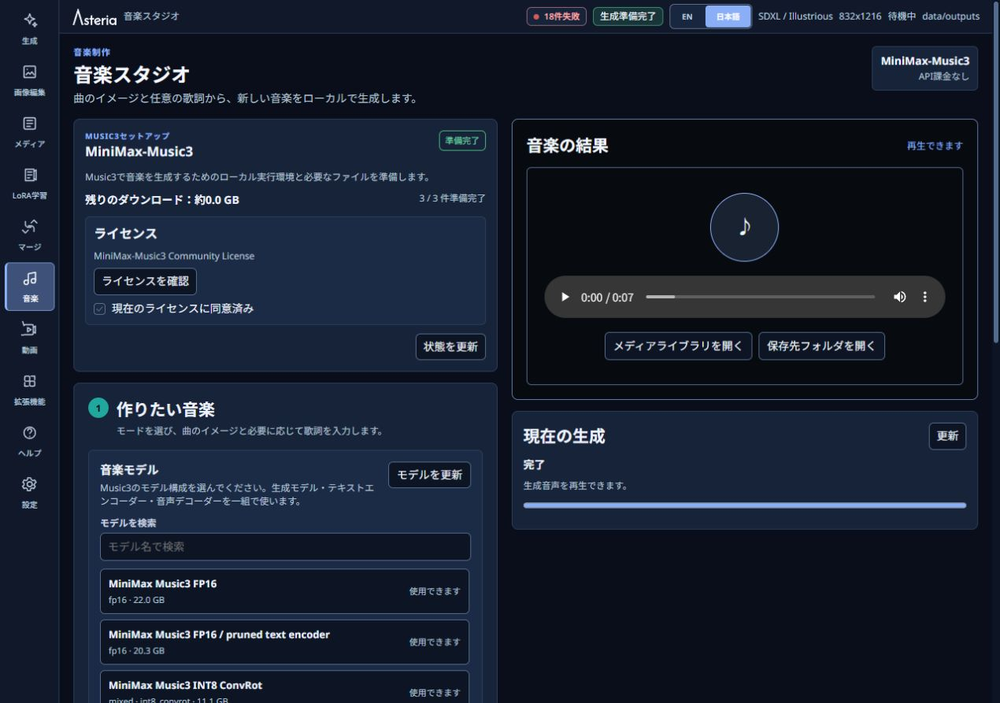

# Music Studio / ミュージックスタジオ

[日本語](#日本語) | [English](#english) | [README](../README.md)

準備状況と音声の表示例です。新しい曲を作る場合は下へ進み、「ボーカル曲」か「インストゥルメンタル」を選んでください。

Setup and the audio result area are shown. Continue below to select Vocal or Instrumental for a new track.

## 日本語

左メニューの「音楽」を開くと、**MiniMax-Music3**で新しい曲を作れます。V1.2.0では**Vocal**と**Instrumental**の新規生成に対応します。カバー、リミックス、ステム分離、DAW連携、マスタリングは対象外です。

APIの選択、APIキー、認証情報、課金設定はありません。ローカル生成に失敗しても、有料APIへ自動で切り替わりません。既存の音声ファイルを生成条件として入力する機能もありません。

### 使い方

1. **ボーカル曲（Vocal）**または**インストゥルメンタル（Instrumental）**を選びます。
2. 曲の説明を入力します。ジャンル、雰囲気、楽器、テンポ、構成、声のイメージなどを自然文で指定できます。
3. ボーカル曲では必要に応じて歌詞を入力します。
4. Seed、長さ、言語を設定し、「音楽を生成」を押します。Seedは通常`-1`にすると、毎回新しい初期状態を使います。同じSeedでも同一の音声を保証するものではありません。

MiniMax-Music3が未導入の場合は、セットアップカードで必要な空き容量とライセンスを確認します。同意欄を選び、**同意してダウンロード**を押してください。メモリの使用方法は実行環境が管理するため、この画面で実行プロファイルを選ぶ必要はありません。

設定によって負荷が高くなる場合は、GPU、メモリ、空き容量の見積もりと警告を表示します。警告は実行を禁止するものではありません。内容を確認し、続行する場合は**このまま実行**を選びます。

生成後はその場で試聴し、保存するかMedia Libraryを開けます。失敗した処理は**再試行**を選ぶと、同じ設定でもう一度実行できます。

### Media Library からの再生成

生成音声で**音楽スタジオで再生成**を選ぶと、説明、歌詞、モード、シードなどの生成設定だけをMusic Studioの下書きへコピーします。元の音声ファイルは入力素材として送りません。

## English

Open **Music** in the left menu to create new music locally with **MiniMax-Music3**. V1.2.0 supports new **Vocal** and **Instrumental** generation. Cover, Remix, stem separation, DAW, and mastering are outside this scope.

There is no API selector, API key, credential storage, billing flow, or paid fallback. Audio files cannot be used as Music Studio conditioning sources.

### Basic flow

1. Choose **Vocal** or **Instrumental**.
2. Describe the song in natural language: genre, mood, instruments, tempo, structure, and voice intent are all useful.
3. Add lyrics when creating a Vocal track.
4. Set the Seed, duration and language, then press **Generate music**. Normally, use Seed `-1` for a fresh starting point. Reusing a Seed does not guarantee identical audio.

If MiniMax-Music3 is not ready, review the required space and license in the setup card, select the agreement checkbox, then press **Agree and download**. The runtime manages memory use; this screen does not require you to select an execution profile.

GPU/VRAM, RAM, disk, and workload estimates may produce a `caution` or `high risk` advisory. This is not a hard block; review it and choose **Run anyway** when you want to proceed.

Preview the result in the built-in player, save it, or open Media Library. A failed job can be retried with **Retry**. A local failure never silently switches to an API provider.

### Regenerate from Media Library

**Regenerate in Music** copies request settings such as description, lyrics, mode, and seed into a Music Studio draft. It does not send the existing audio artifact as a conditioning source.
