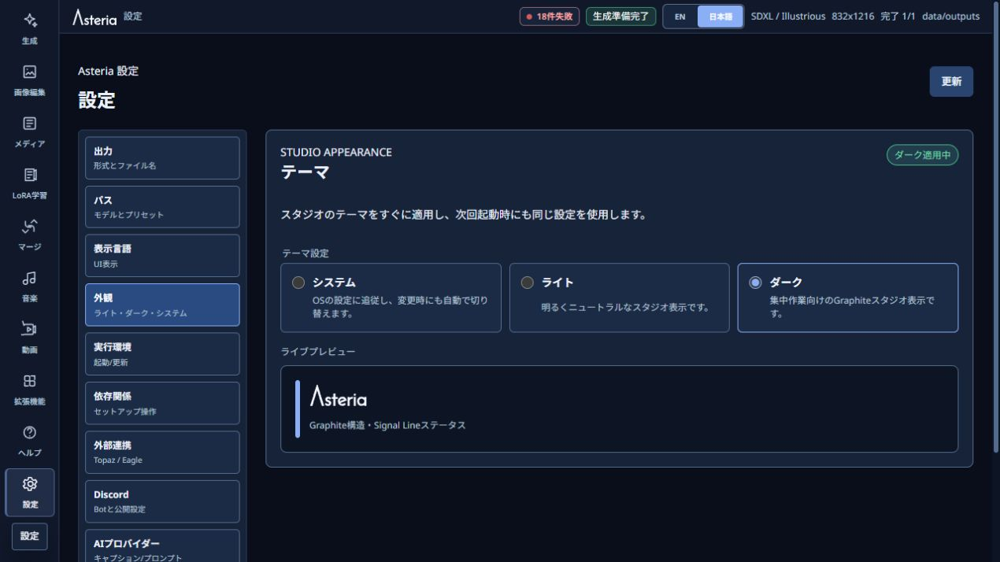
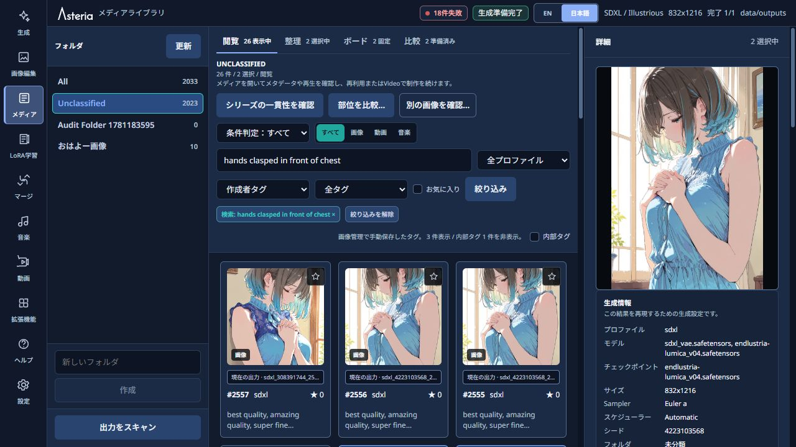
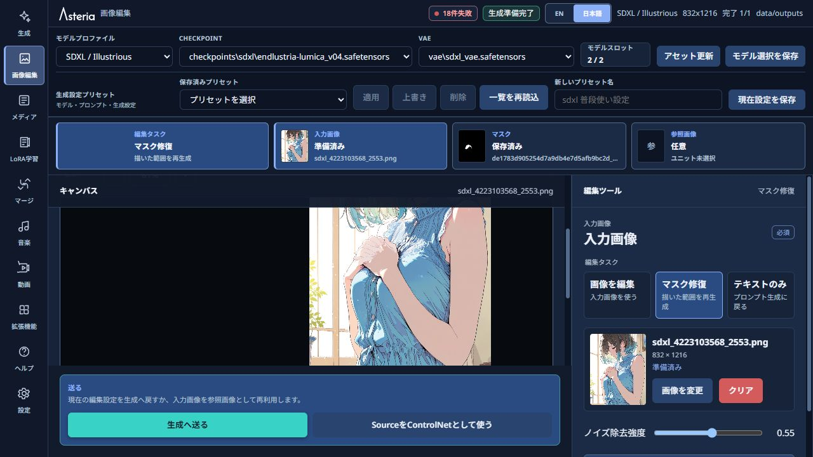
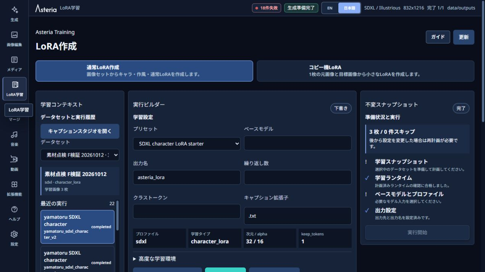

# 最初の生成と編集 / Quick start

[日本語](#日本語) | [English](#english) | [README](../README.md)

## 日本語

起動方法や必要なPC環境は[README](../README.md)を参照してください。このガイドは、モデルを用意してAsteriaを起動した後の操作を説明します。画面例はDarkモード・日本語表示です。表示するモデルや画像は環境によって異なります。

### 1. 表示を選ぶ

左の「設定」→「外観」で、ライト・ダーク・システムから選びます。変更はすぐに反映されます。表示言語は上部のEN／日本語から切り替えられます。

### 2. 一枚生成する

1. 左の「生成」を開き、モデルプロファイル、Checkpoint、必要なVAEを選びます。未導入の場合はモデルを追加するか、Settingsの起動準備を確認してください。
2. 描きたい内容とネガティブプロンプトを入力します。「項目別に入力」は文章を三欄に整理する機能であり、人物の位置を指定するものではありません。
3. 右の「基本設定」でサイズ、Samplingステップなどを選びます。通常はSeedを`-1`にして、毎回新しい値を使います。
4. 「生成」を押し、完成画像を確認します。中断したいときは「停止」を押します。自動リピートをONにした場合は、終了条件も確認してください。

画面例は通常生成の完成画像です。再生成用のSeedや設定は履歴に残りますが、別の実行環境で画素まで同じになる保証はありません。詳しい比較や途中状態の保存は[制作支援ガイド](CREATIVE_WORKFLOWS.md)を参照してください。

### 3. Libraryで選ぶ

「メディア」で画像・動画・音声を確認します。画像カードを選ぶと、右にプレビューと設定が表示されます。Ctrl＋クリックで複数選択し、整理や比較へ進めます。動画・音声は詳細のプレーヤーから再生します。

人体部位レビューと複数画像の部位比較は、検出候補を自分で確認するための機能です。人体の正常性や部位の所属は判定しません。操作と任意モデルの用意は[制作支援ガイド](CREATIVE_WORKFLOWS.md)を確認してください。

### 4. 必要な範囲だけ編集する

Libraryの「画像編集で開く」から入力画像を選び、マスクを描きます。任意のSAMがある場合は、人体部位レビューで作った実マスクも使えます。色付きの範囲を確認し、ブラシ・消しゴムで直してから生成へ送ってください。元画像を直接上書きする操作ではありません。

### 5. 学習やMergeへ進む

LoRA学習では画像とcaptionを用意し、学習内容を確認してから開始します。キャラクター用captionは、先頭のトリガーを残し、それに覚えさせたい固定特徴を文章から外してください。AIの点検候補は自動適用されません。

Mergeでは、対象のモデルと方式を選び、設定を確認して実行します。プレビューや比較を使い、生成画像で結果を判断してください。以下は設定画面の例であり、Merge結果の品質を示す画像ではありません。

### 6. 目的に合うガイドを開く

- [プロンプト・生成過程・部位レビュー・再生成](CREATIVE_WORKFLOWS.md)
- [完成画像のチェックと保存の扱い](IMAGE_CHECK.md)
- [画像・動画・音声の管理](MEDIA_LIBRARY.md)
- [動画の作成](VIDEO_STUDIO.md)
- [曲の作成](MUSIC_STUDIO.md)
- [拡張機能の導入と復旧](EXTENSIONS.md)

画像チェックは任意です。ONの場合は、すべての生成・補正を終えた完成画像を正式保存前に一回確認します。AIの見逃しや誤判定は残ります。終了するときは、ブラウザーを閉じるだけでなく`Stop-Asteria.cmd`を実行してください。

## English

See the [README](../README.md) for installation and hardware requirements. This guide starts after Asteria is running and you have compatible models. Screenshots show the Japanese interface in Dark mode; your models and images will differ.

### 1. Choose your display

Open Settings → Appearance and choose Light, Dark or System. The theme changes immediately. Use EN / 日本語 at the top to switch language.

### 2. Generate one image

1. Open Generate and select the model profile, checkpoint and required VAE. Add a compatible model or review Ready to start in Settings if needed.
2. Enter the positive and negative prompts. Sectioned input organizes text; it does not assign people to spatial regions.
3. Choose dimensions and sampling settings in Basic settings. Use Seed `-1` for a fresh value during ordinary generation.
4. Press Generate and inspect the completed image. Stop cancels an ongoing run. Review the stop conditions before enabling automatic repeat.

History retains the Seed and settings, but pixel-identical output across execution environments is not guaranteed. See [Creative workflows](CREATIVE_WORKFLOWS.md) for comparisons and saved intermediate states.

### 3. Choose media in Library

Open Media to browse images, video and audio. Select an image card to see its preview and settings. Ctrl+click selects multiple items for organization or comparison. Video and audio play from their detail players.

Body-part review and same-part comparison show detection candidates for your inspection, not anatomical correctness or ownership judgments. See [Creative workflows](CREATIVE_WORKFLOWS.md) for their optional models and operations.

### 4. Edit a selected region

Use Open in Image Edit from Library and draw a mask. With optional SAM available, you can also use a real mask from Body-part review. Inspect the colored region, refine it with the brush or eraser, then send it to Generate. This does not directly overwrite the original image.

### 5. Continue to training or Merge

Prepare images and captions in LoRA Training, inspect the configuration, then explicitly start training. For character captions, keep the trigger first and omit stable features that the trigger should recall. AI review suggestions do not apply themselves.

In Merge, choose the models and method, review the configuration and explicitly run it. Judge the result using generated images and comparisons. The screenshot shows configuration, not evidence of merge quality.

### 6. Continue with the relevant guide

- [Prompts, generation stages, body parts and regeneration](CREATIVE_WORKFLOWS.md)
- [Completed-image checks and saving](IMAGE_CHECK.md)
- [Image, video and audio management](MEDIA_LIBRARY.md)
- [Video creation](VIDEO_STUDIO.md)
- [Music creation](MUSIC_STUDIO.md)
- [Extension installation and recovery](EXTENSIONS.md)

Image checking is optional. When enabled, it runs once after all generation and enhancement, before formally saving the completed image. AI can still miss defects or report false positives. Run `Stop-Asteria.cmd` when finished; closing a browser tab alone does not stop Asteria.
