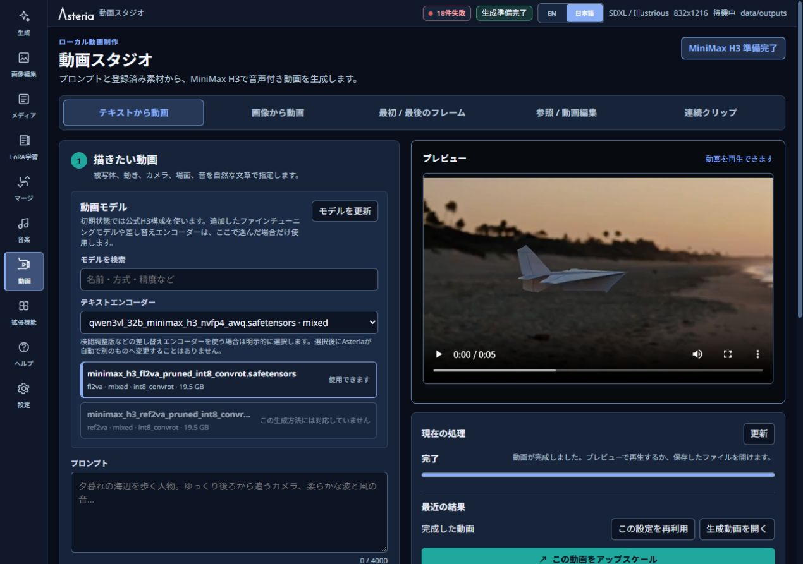

# Video Studio / ビデオスタジオ

[日本語](#日本語) | [English](#english) | [README](../README.md)

入力設定と保存済みプレビューの表示例です。画質は設定やモデルによって異なります。 / Configuration and a previously saved preview are shown. Quality depends on the settings and model.

## 日本語

左メニューの「動画」を開くと、**MiniMax H3**で動画を作成できます。処理にはAsteriaが管理するComfyUIを使います。V1.2.0ではAPI版を使用しないため、APIの選択やキー・課金設定はありません。

### 5つのタスク

1. **テキストから動画** — 描きたい場面を文章で指定
2. **画像から動画** — メディアライブラリの画像を入力
3. **最初 / 最後のフレーム** — 開始画像と終了画像を指定
4. **参照 / 動画編集** — 画像・動画・音声を参照素材として使用
5. **連続クリップ** — クリップを確認しながら順番に連結

タブを切り替えても、タスクごとの入力内容は保持されます。生成物は Video Studio だけでなく Media Library にも保存されます。

### 初回セットアップ

MiniMax H3が未準備の場合は**MiniMax H3をセットアップ**を選びます。必要な空き容量、推奨条件、ライセンスの概要、公式リンクを確認してください。同意欄を選んで**同意してダウンロード**を押すと、必要なモデルを取得します。Asteriaはモデルをアプリ本体へ同梱しません。

### 生成と長さ

タスクを選び、プロンプトと必要な入力素材を指定します。モデル、秒数、解像度などを確認して「動画を生成」を押してください。連続クリップでは「現在のクリップを生成」を使います。

秒数、解像度、参照素材数にAsteria独自の固定上限はありません。モデルに合わせてフレーム数を調整する場合は、指定した値、実際に生成する値、調整理由を実行前に表示します。設定によって負荷が高くなる場合は、GPU、メモリ、空き容量の見積もりと警告を表示します。警告は機能制限ではありません。内容を確認し、続行する場合は**このまま実行**を選びます。セットアップ不足や入力エラーなど、実行できない理由が確定している場合だけ修正が必要です。

### Sequence の流れ

各クリップは必ずプレビューしてから、次のいずれかを選びます。

- **このクリップを再試行**: 現在のクリップだけ作り直す
- **採用して次へ**: 現在のクリップを採用し、次のクリップを作る
- **採用して完成**: 現在のクリップを採用し、採用済みのクリップを連結する

未確認のクリップから自動で次へ進むことはありません。完成動画だけでなく採用クリップも Media Library に残り、Sequence の詳細から確認できます。差し替え後の続きは再生成が必要ですが、連結に失敗した場合はクリップを作り直さず連結だけ再試行できます。

### Media Library からの受け渡し

- 画像の **画像から動画** は選択した画像そのものを入力にします。
- 画像・動画・音声の **参照 / 動画編集** は選択した素材そのものを参照にします。
- 別の素材へ勝手に置き換えません。利用できない組み合わせは理由付きで無効になります。

## English

Open **Video** in the left menu to create videos with **MiniMax H3** through Asteria-managed ComfyUI. V1.2.0 does not use the hosted API, so there is no API selector, API key, billing flow, or automatic paid fallback.

### Five tasks

1. **Text to Video** — generate from text
2. **Image to Video** — animate an image from Media Library
3. **First / Last Frame** — choose the starting and ending images
4. **Reference / Video Edit** — use image, video, or audio references
5. **Sequence** — review and join clips one at a time

Each task keeps its own draft when you switch tabs. Results are stored in Media Library as well as shown in Video Studio.

### Setup, duration, and advisories

Choose **Set up MiniMax H3** when the runtime is not ready. Review the required space, recommended conditions, license summary, and official link; then agree and press **Agree and Download**. Models are not bundled with Asteria.

Asteria does not impose its own fixed duration, resolution, or reference-count limit. If the model requires frame alignment, the requested value, generated value, and reason are shown before submission. Best-effort GPU/VRAM, RAM, and disk estimates may show `caution` or `high risk`. These are advisories, not feature limits; after reviewing one, you can choose **Run anyway**. Only deterministic setup or input failures require correction.

Select a task, enter the prompt and required media, and review the model, duration and resolution. Press **Generate video** to start, or **Generate current clip** in Sequence.

### Sequence review flow

Every clip stops at preview. Choose:

- **Retry** to regenerate only the current clip;
- **Accept and continue** to keep it and create the next clip;
- **Accept and finish** to assemble the accepted clips and stop.

Asteria never continues automatically from an unreviewed clip. Both the finished video and accepted clips remain in Media Library. Replacing an accepted clip requires regenerating the later continuation; an assembly-only failure can be retried without regenerating clips.

### Media Library handoffs

- **Image to Video** uses the selected image artifact.
- **Reference / Video Edit** uses the selected image, video, or audio artifact as the reference.
- Asteria does not silently substitute another artifact; unsupported actions show a reason and remain disabled.
